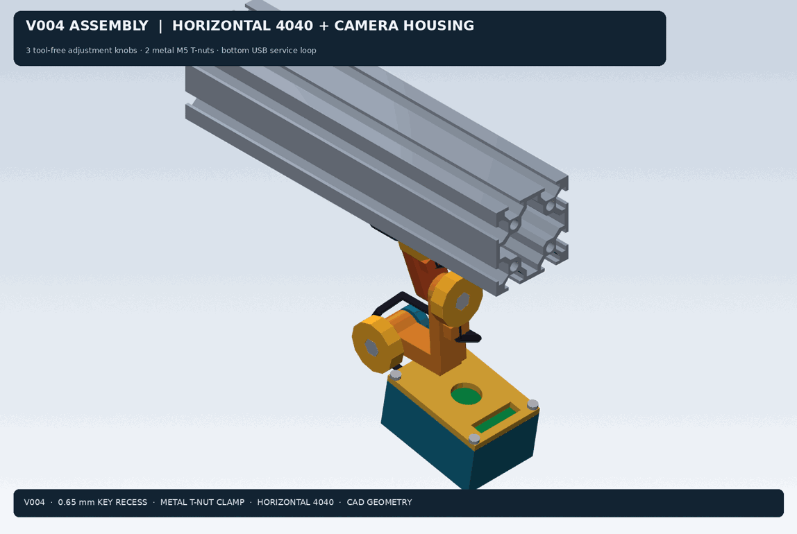
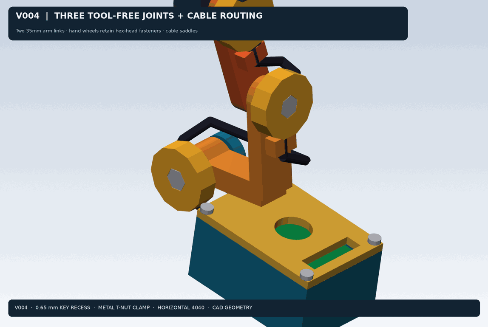
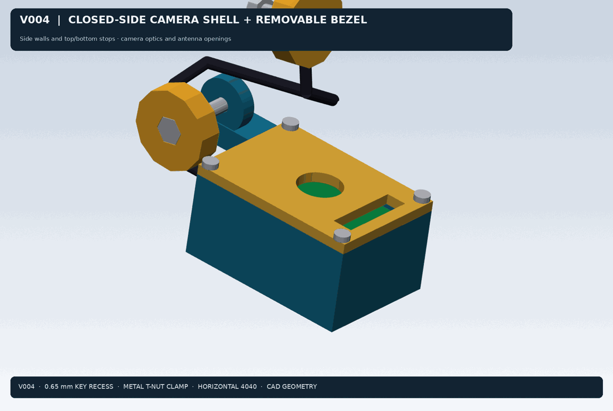
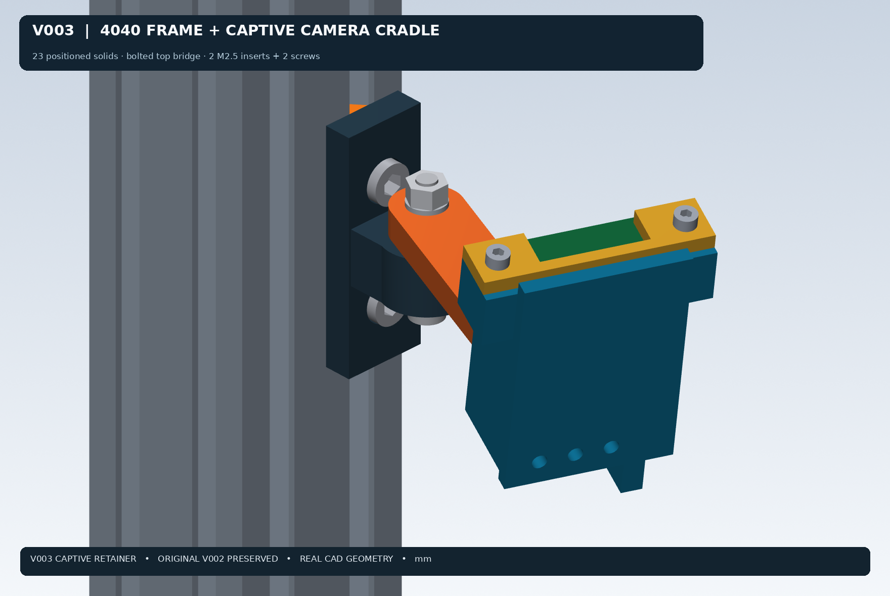
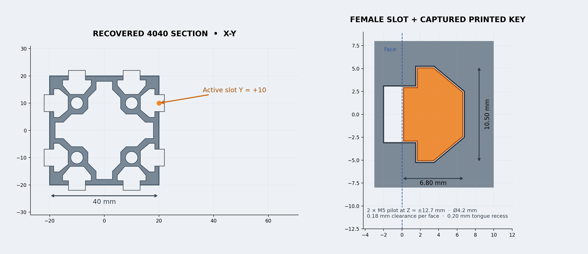
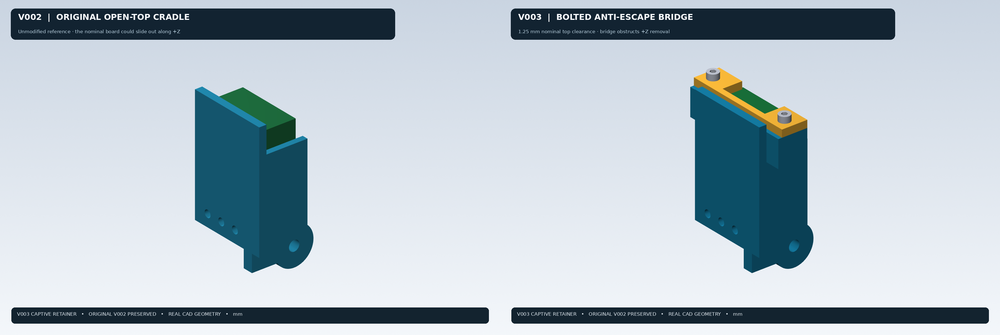
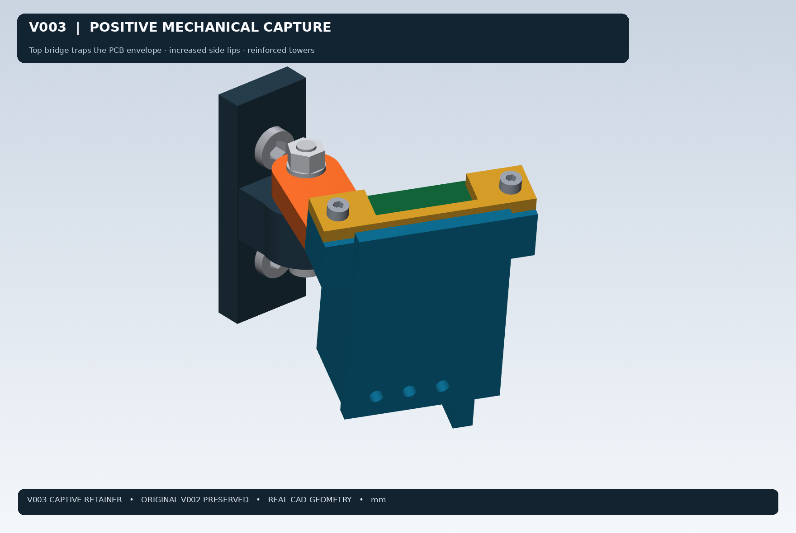
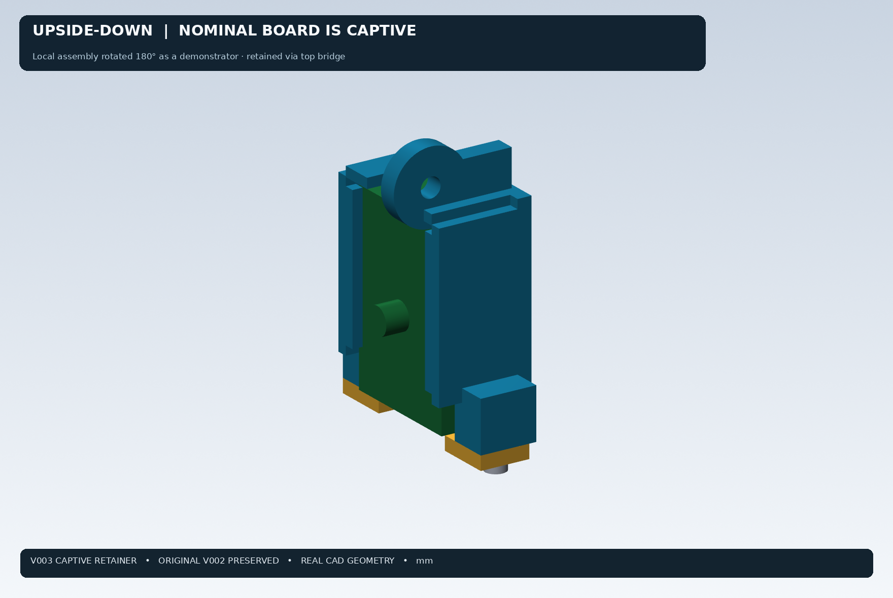
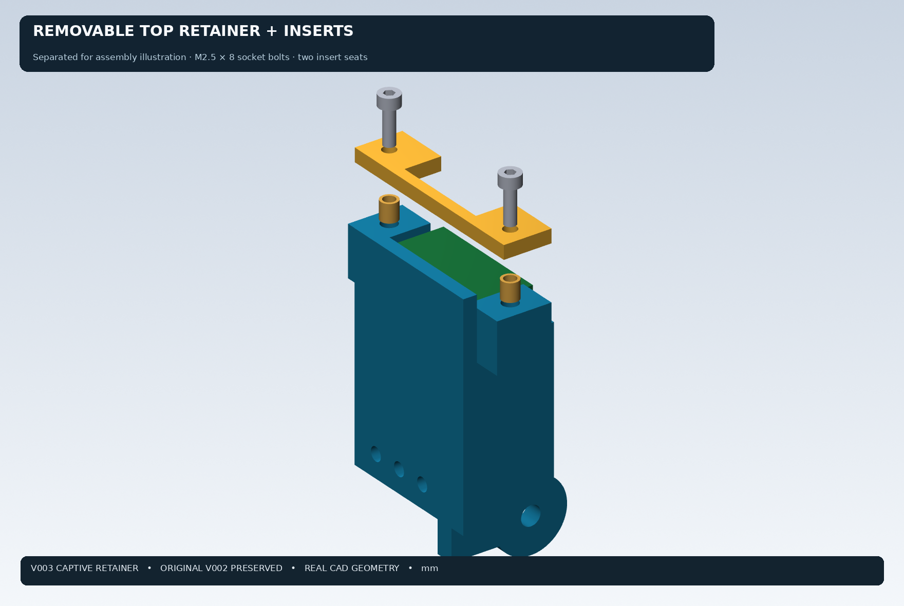
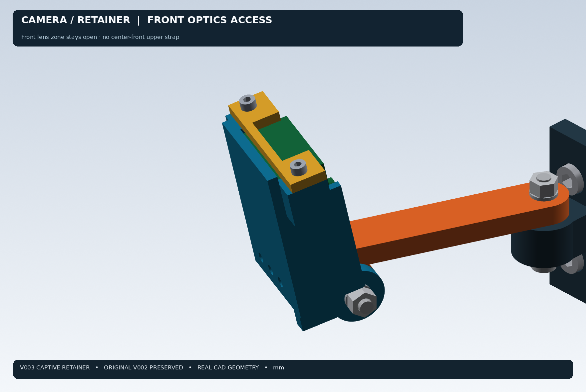

# ESP32-CAM-MB | Parametric Frame Monitor

**A little camera, a 4040 extrusion, and a lot of iterative CAD.**  
*Designed by [Cdaprod](https://github.com/Cdaprod) · Python/CadQuery · 3D printing · Open hardware prototype*




## V004 — the changes I made after mounting it horizontally

I started this as a small camera mount, but a useful engineering project needs more than a nice-looking render. When I looked closely at the original assembly, five details needed to change: the key's clamp clearance, the rail orientation, hand-operated articulation, full cradle retention, and the power-cable path.


V004 now uses the **horizontal 4040 front-rail configuration**. A short captured alignment key stays **0.65 mm below the rail face**, while two actual **metal T-nuts** (shown as nominal CAD envelopes) receive the M5 clamp bolts. The printed key is there to align the mount, **not** to become the structural screw thread.



There are **three hand-operated M4 pivot wheels** across two short articulated links, so I can reposition the camera without reaching for a wrench every time. Each wheel captures the metal screw head; the receiving parts include captive hex-nut pockets. The cable exits at the **bottom of the housing**, makes a service loop, and follows the link saddles back to the rail.



The previous camera cradle was still visually open along its side. This one is a **full perimeter enclosure**, with continuous left and right side walls, a removable four-screw front bezel, an optical opening, an antenna window, and a bottom USB outlet. The nominal camera is blocked in all six axial motion directions, and the bezel can be removed for maintenance.

**Validated in CAD:** 26 assembled component/reference entries, seven watertight printable meshes, six retained motion directions, 27 sampled articulation poses, and zero interference across the checked mating components. **Not yet validated physically:** actual ESP32-CAM-MB fit, rail profile, screw torque, printer travel, cable strain or vibration. Camera pitch has a **0° to +30° validated range**; negative tilt is not approved due to a housing/support collision.

- [V004 full STEP assembly](step/COMPLETE_4040_ESP32_CAM_MB_ASSEMBLY_V004.step)
- [Python model source](src/build_v004.py) · [validation](src/validate_v004.py) · [renderer](src/render_v004.py)
- [V004 engineering corrections and fit requirements](docs/ENGINEERING_NOTES_V004.md) · [V004 hardware BOM](docs/BOM_V004.csv)

The prior V003 project remains intact below. V004 is a new revision, **not an overwrite**.

---

## Why I built this

I’m a software and systems engineer who likes connecting the physical and digital worlds. I spend a lot of time building things, breaking assumptions, measuring twice, and turning my tools into systems I can improve. This project started with a practical question: **could I mount an inexpensive ESP32-CAM-MB to my printer frame, point it at the bed, and still be able to reposition or service the camera without starting over?**

Instead of gluing a camera to the printer or publishing a one-off bracket, I wanted the whole assembly to be parametric. The 4040 rail and undercut T-slot key give me a reusable mechanical interface. The arm adds positioning. The cradle adds board retention. And each version records *why* a design changed.

The best part is that the CAD isn't just a pretty render: the Python source regenerates the parts and assembly, the STEP and STLs are here, and the images below come from the actual CAD geometry.

> **Historical release: V003 — captive cradle (V004 now adds the horizontal mounting improvements).** V002 is preserved exactly in `reference/V002_original_preserved.zip`. This is a prototype: the photographed/recovered rail geometry and nominal camera-stack envelope still need caliper confirmation against your physical hardware.

## The build, in pictures

### 1 — The full 4040 assembly



A 40 × 40 × 180 mm reference extrusion, a captured undercut sliding key, a mounting plate, a 60 mm arm, and a camera cradle. All the screws, washers, locknuts and inserts are modeled in the demonstration. The recovered rail has two slots per face, on **20 mm centers**; we mount on an actual offset slot, not a fictional central slot.

### 2 — The connection that started it all



My recovered parametric T-slot interface is intentionally *captured by the extrusion undercuts* rather than being a loose rectangular tab. In the demo, the two M5 fasteners align with the pilot holes in the sliding key. **For a printer running under vibration or heat, substitute an appropriate metal T-nut/fastener interface**: the tapped-plastic connection is only a geometric prototype.

### 3 — The problem with V002



V002 positioned the camera but left an escape path along the open top. That’s fine while it is upright on a desk, but it is not a design I'd trust when I flip or tilt the camera to get the bed shot I want.

### 4 — A cradle I can turn upside down



V003 keeps the original arm and frame interface and changes only the cradle assembly. It adds **two reinforced towers, wider front lips, and a removable U-shaped top retainer** fixed by **two M2.5 screws into brass inserts**. No dependence on a fragile snap-fit and no need to glue the board in forever.



The nominal board is blocked in all six axis-aligned translation tests in the CAD model. This is a *geometric test*, not a real inversion/drop/vibration qualification; I'll still test the print before it gets installed on a moving machine.

### 5 — How the retainer goes together





The bridge can come back off when I want to reflash or swap the board. The front optics remain unobstructed in the nominal envelope; real antenna, USB plug, headers and cable-strain relief must be measured.

## At a glance

| Parameter | Demonstration value | Notes |
|---|---:|---|
| Reference extrusion | 40 × 40 × 180 mm | Photo-derived 4040 profile; verify real rail |
| Slots on each face | 2, ±10 mm from center | Not a centered single-slot profile |
| Articulated arm | 60 mm | Original V002 arm retained |
| ESP32-CAM-MB envelope | 27 × 40 × 16 mm | **Provisional** assembly dimensions |
| Printable parts | 5 | Individual STEP + watertight STL exports |
| Assembled STEP | 23 named solids | Includes simplified fastener representations |
| Base fasteners | 2 × M5 × 8 | Printed pilot/key demonstrator only |
| Pivot hardware | 2 × M4 × 25 | Yaw and pitch joints |
| Cradle screws | 2 × M2.5 × 8 | Into nominal brass heat-set inserts |
| Nominal top gap | 1.25 mm | Confirm physical PCB fit before printing |

## Files I actually use

```text
ESP32-CAM-MB-Parametric-Frame-Monitor/
├── README.md                     # This story and embedded geometry previews
├── previews/                     # Nine real, tracked PNG renders
├── src/                          # Python CAD builders, renderers, validators
├── reference/                    # Original OpenSCAD T-slot and V002 ZIP
├── step/                         # Full assembly and independently editable solids
├── stl/                          # Five individual printable models
├── viewer/                       # Offline HTML viewer and colored GLB
├── docs/                         # BOM, parameters, validation, provenance
├── tests/                        # Lightweight repo/integrity check
└── .github/workflows/            # Documentation/assets CI
```

**Start with these:** [`full assembled STEP`](step/COMPLETE_4040_ESP32_CAM_MB_ASSEMBLY_V003.step) · [`captive cradle STL`](stl/V003_anti_inversion_cradle.stl) · [`top retainer STL`](stl/V003_bolted_top_retainer.stl) · [`offline viewer`](viewer/OPEN_V003_OFFLINE.html) · [`bill of materials`](docs/BOM.csv).

The offline viewer is self-contained. For the most dependable viewing experience, download or clone the repo and open the HTML file locally. You can also open the GLB in a compatible 3D viewer.

## Rebuild from Python

Requires **Python 3.11+**, CadQuery and supporting rendering/mesh libraries. The original build uses CadQuery, Shapely, Trimesh, NumPy, Matplotlib, VTK, Plotly, and Pillow. The software environment is not pinned in this version, so dependency changes may affect reproduction.

`/src/build_v003.py`

```bash
python -m pip install cadquery shapely trimesh numpy matplotlib vtk plotly pillow
python src/build_v003.py
python src/validate_v003.py
python src/export_viewer_v003.py
# Headless Linux:
xvfb-run -a python src/render_v003.py
# Desktop macOS:
python src/render_v003.py
```

Read [`docs/validation_v003.json`](docs/validation_v003.json) for the source CAD check results and [`docs/provenance.json`](docs/provenance.json) for the archived V002 checksum. A small standard-library CI test checks that every README-linked local image exists and that the original V002 archive remains present and readable.

## What I will verify on the real printer

- Exact ESP32-CAM-MB overall stack height and component projections, USB cable direction, lens and antenna access.
- Actual extrusion profile and slot width at the selected front corner, including whether the mounting face has this *specific* 4040 double-slot geometry.
- Heat-set insert manufacturer's hole and depth recommendations, print orientation and layer adhesion.
- Printer travel clearance, cable snag zones, heat, vibration and a physical upside-down retention test.

I don't want a STEP model that only looks convincing. I want parts whose geometry, assumptions, and limitations are all visible so the next design iteration is based on measurements rather than guesses.

## Version history

- **V001 —** modular base, articulated arm and initial ESP32-CAM-MB cradle.
- **V002 —** unified 4040 extrusion + captured parametric key + monitor assembly, with modeled fasteners.
- **V003 —** separate bolted retainer, insert towers and stronger retaining lips; unchanged upstream rail/arm geometry, V002 archived byte-for-byte.

For the full detailed assembly instructions, tolerances, numerical register and geometric validation method, see [`docs/ENGINEERING_NOTES_V003.md`](docs/ENGINEERING_NOTES_V003.md).

---

*Built by [Cdaprod](https://github.com/Cdaprod) — part of my ongoing effort to build useful tools, learn by making, and share the actual source rather than only a screenshot.*  
**#DevOpsDad · #HackThePlanet · #3DPrinting · #OpenHardware**
