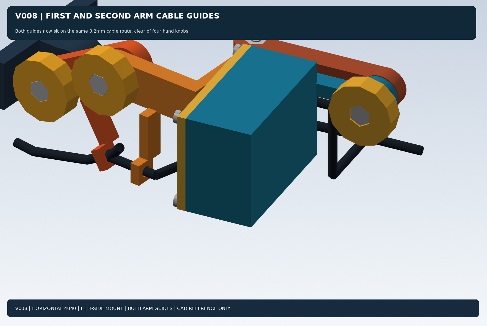
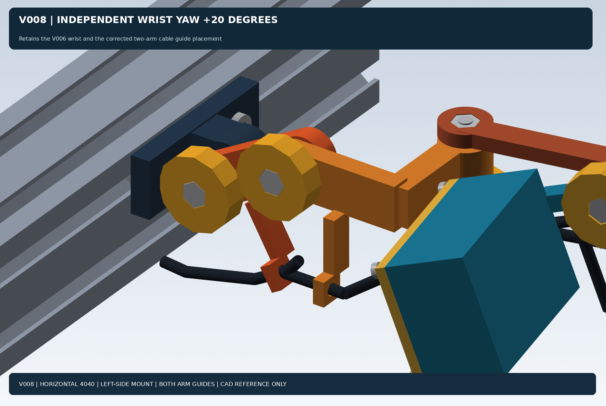

# ESP32-CAM-MB | Parametric Frame Monitor

**A tiny camera, a 4040 rail, four tool-free joints, and one properly aligned cable route.**

*Built by [Cdaprod](https://github.com/Cdaprod) · Python/CadQuery · FreeCAD-compatible STEP · Open hardware prototype*

**Previous verified reference release: V008.** New V009 build and validation are in progress. Physically unverified; dimensional assumptions remain provisional.


## V009 — Tapered structural-link redesign

**Current source revision: V009.** Both articulated arms now have tapered 14–18 mm structural profiles with two triangular lightening cells and a diagonal web, while maintaining the 4040 left-side rail configuration, four joint axes, camera shell, and both V008-aligned USB guide bores. This is a topology-inspired geometry, **not** a load-rated topology optimization. CAD and physical clearance qualification remain required.

Read [V009 engineering notes](docs/ENGINEERING_NOTES_V009.md). Run `xvfb-run -a python src/build.py all` to regenerate the V009 STEP, STL, validation JSON and actual CAD PNGs. V008 imagery and historical references below remain available for comparison.

---

## Why I'm building this

My goal is simple: monitor the bed of my 3D printer with an affordable ESP32-CAM-MB, without gluing the camera to the printhead or hard-locking it into one viewing angle. I want something I can mount on the stationary chassis, adjust by hand, open for servicing, and reproduce entirely from Python.

The screenshots told me the cable wasn't actually passing through either arm's printed cable guide. That wasn't just a cosmetic problem. It meant the model had *two conflicting geometric sources of truth*: arm-local guide placements from V004 and a different USB route from V006. I fixed both arms together and turned the correction into one unified parametric build system rather than adding another chain of patched scripts.

## V008 — Both cable guides now share the actual cable centerline



The 4040 rail stays **horizontal**, with the mount attached to its left/outside face and the camera looking back over the rail toward the build plate. Two **M5 metal T-nuts** provide the clamping force; the undercut printed key is recessed by **0.65 mm**, so it locates without bottoming out before the mounting plate bears on the extrusion.

There are four hand-adjustable joints: base, elbow, camera pitch, and the independent camera wrist yaw added in V006. The full-sided ESP32-CAM-MB shell, four-screw bezel, antenna opening and bottom USB outlet remain unchanged. V008 replaces **both articulated arm link geometries** with supported through-bored cable guides positioned by the same configuration coordinates as the routed USB lead.

The new first-arm guide is at local **X = −27, Y = −32, Z = 19 mm** and the second is at **X = −27, Y = −69.2, Z = 27 mm**. Each bore is nominally **Ø3.8 mm** for a modeled **Ø3.2 mm** cable, giving **0.30 mm radial clearance**. The elbow cable handoff has an additional 4 mm lateral transition to avoid grazing the distal arm support at the sampled extreme elbow pose.



### Validation gate (CAD only)

| Requirement | Verified modeled result |
|---|---:|
| Assembly component/reference entries | 30 |
| Adjustable thumbwheel joints | 4 |
| Poses tested | **13 / 13 pass** |
| Cable-to-both-guide radial clearance | **0.30 mm nominal** |
| Cable-to-thumbwheel minimum distance | **7.132 mm** |
| Cable-to-4040 minimum distance | **3.802 mm** |
| New individual watertight STL files | **2 / 2** |
| Actual printer, camera and cable physical fit | **Unverified** |

This is a **selected 13-pose geometric test**, not a continuous collision-free 4-DOF motion certification. Cable sag, bend radius, strain relief, connector boot, printed cantilever fatigue, fastener torque, printer travel, thermal behavior and vibration still require physical testing.

## One reproducible build command

The active source is now the self-contained [`src/frame_monitor/`](src/frame_monitor/) package, not an inheritance chain of versioned scripts. One [`src/build.py`](src/build.py) command produces the current assembly, printable parts, JSON validation, and actual CAD renders. Earlier revision scripts remain as immutable historical references.

`/src/build.py`

```bash
python -m pip install -r requirements.txt
python src/build.py build       # V008 assembly STEP + 2 new arm STLs/STEPs
python src/build.py validate    # 13-pose cable, knob, rail and guide clearance
xvfb-run -a python src/build.py render  # Headless Linux CAD renders
# Or run all three stages:
xvfb-run -a python src/build.py all
```

## Source and printable artifacts

| Component | Current link |
|---|---|
| Full assembled rail, arm, enclosure and fasteners | [V008 complete STEP](step/COMPLETE_4040_ESP32_CAM_MB_ASSEMBLY_V008.step) |
| Corrected first arm | [STL](stl/V008_first_arm.stl) · [STEP](step/V008_first_arm.step) |
| Corrected second arm | [STL](stl/V008_second_arm.stl) · [STEP](step/V008_second_arm.step) |
| Parametric config and both guide bores | [config.py](src/frame_monitor/config.py) · [geometry.py](src/frame_monitor/geometry.py) |
| Cable centerline and joint handoffs | [cable.py](src/frame_monitor/cable.py) |
| Assembly and export | [assembly.py](src/frame_monitor/assembly.py) · [export.py](src/frame_monitor/export.py) |
| Tests | [validate.py](src/frame_monitor/validate.py) · [validation JSON](docs/validation_v008.json) |
| Rendering | [render.py](src/frame_monitor/render.py) |
| Current BOM and physical fit register | [BOM](docs/BOM.csv) · [Fit register](docs/PHYSICAL_FIT_REGISTER_V008.csv) |

The rest of the print set is unchanged from V004/V006: V004 alignment key, base plate, removable bezel and thumbwheel (four required), plus V006 wrist adapter and camera shell. **Do not use the original V004 or V007 first/second arms for the V008 routed cable.**

## History that stays in the repo

| Revision | Milestone |
|---|---|
| V001 | Initial parametric frame camera mount |
| V002 | Complete 4040 + captured undercut key with modeled screw hardware |
| V003 | Bolted anti-inversion camera retention |
| V004 | Recessed key, metal T-nuts, horizontal arm, three hand knobs, sidewall case |
| V005 | Correct left-side frame installation pointing back over the horizontal rail |
| V006 | Independent wrist yaw, fourth thumbwheel, outboard power cable |
| V007 | Unreleased candidate that identified the two misplaced cable saddles |
| **V008** | **Unified active build package, both corrected guides and tested cable alignment** |

Historical exports and the offline V003 viewer remain versioned references; they are not the current V008 model. The recovered T-slot OpenSCAD sources and the original V002 ZIP are retained for provenance.

My next physical tasks are to measure the exact ESP32-CAM-MB stack and USB connector boot, test guide fit on a short coupon, confirm the real 4040 slot/T-nut hardware, and sweep the machine through its full movement envelope with an actual flexible cable.

---

*Built by [Cdaprod](https://github.com/Cdaprod). Code meets hardware, and every engineering correction gets a reproducible source revision.*

**#DevOpsDad · #HackThePlanet · #3DPrinting · #OpenHardware**