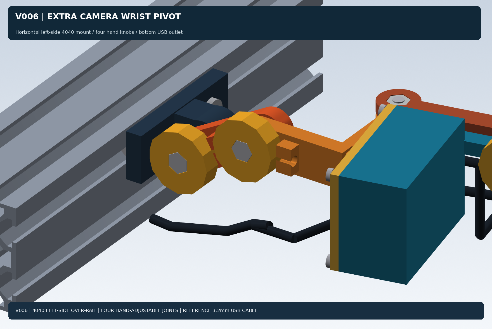
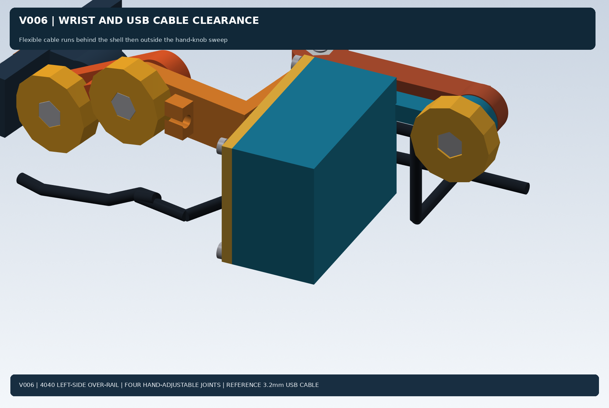
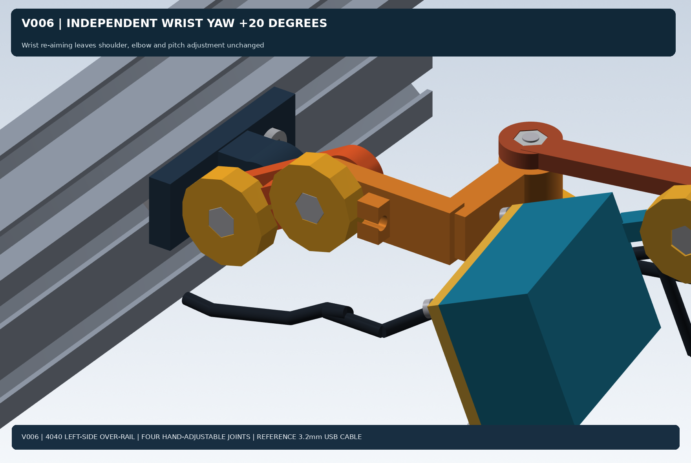

# ESP32-CAM-MB | Parametric Frame Monitor

**A little camera, a horizontal 4040 rail, four hand-adjustable joints, and an outboard USB cable.**

*An open Python/CadQuery hardware project by [Cdaprod](https://github.com/Cdaprod).*

**Current release: V006 — CAD-validated prototype; physical fit unverified.**  
[Assembly STEP](step/COMPLETE_4040_ESP32_CAM_MB_ASSEMBLY_V006.step) · [Python generator](src/build_v006.py) · [Validation](docs/validation_v006.json) · [Hardware BOM](docs/BOM.csv) · [Physical fit register](docs/PHYSICAL_FIT_REGISTER_V006.csv)



## Why I'm building this

I'm a software and systems engineer who enjoys making physical hardware programmable, repeatable, and serviceable. I wanted a budget-friendly ESP32-CAM-MB looking back over my printer bed, mounted directly to the stationary frame—not a one-off glued bracket or an unreliable clip.

I began with a parametric T-slot interface, then kept correcting what the geometry and the physical installation demanded: proper metal clamping hardware, a key that cannot bottom out, the correct *left-side* horizontal mounting orientation, a fully captured board, enough adjustment to aim the camera, and an electrical cable that doesn't sweep through the tightening knobs. The source code and earlier revisions are here because the engineering decisions matter as much as the finished render.

V006 is **the current development configuration**. Earlier models are retained as history and references, not current print instructions.

## What's new in V006



The 4040 rail remains horizontal (world X axis). The bracket is on its **left/outside +Y face**, looking back over the rail toward the bed (−Y). Two M5 metal T-nuts carry the clamp load; the undercut printed key is recessed **0.65 mm** and serves only as a locator.

V006 adds a **fourth independent M4 wrist-yaw pivot** between the distal link and the revised camera shell. Base, elbow, pitch, and wrist are all adjusted using captive fasteners and hand wheels. The shell has continuous side walls, a removable optical bezel, antenna access and a lower USB exit.

The illustrated **3.2 mm nominal USB cable** leaves the bottom of the shell, tracks underneath and behind it, and runs outboard of the moving arm links and thumbwheel envelopes.



### CAD results—not physical qualification

| V006 check | Result |
|---|---:|
| Positioned component/reference entries | 30 |
| Independently adjustable hand-wheel joints | 4 |
| Sampled articulation poses passed | 13 of 13 |
| Smallest modeled cable-to-hand-wheel separation | 7.132 mm |
| Smallest modeled cable-to-rail separation | 3.802 mm |
| **New** watertight printable shapes | 2 |
| Real printer, board, cable/boot and fastening fit | **Unverified** |

The [validation JSON](docs/validation_v006.json) reports sampled solid-distance checks. This is **not** proof of continuous collision-free motion, cable bend radius, strain relief, printer-axis travel, load rating, vibration resistance, or thermal safety.

## Files to build the current design

| Purpose | File |
|---|---|
| Complete 4040/camera/hardware assembly | [V006 assembled STEP](step/COMPLETE_4040_ESP32_CAM_MB_ASSEMBLY_V006.step) |
| **New** printable wrist adapter | [STL](stl/V006_wrist_adapter.stl) · [STEP](step/V006_wrist_adapter.step) |
| **New** printable camera shell with wrist leaf | [STL](stl/V006_camera_shell.stl) · [STEP](step/V006_camera_shell.step) |
| Reusable alignment key | [V004 key STL](stl/V004_recessed_alignment_key.stl) |
| Reusable mounting plate | [V004 plate STL](stl/V004_mount_plate.stl) |
| Reusable two arm links | [First link](stl/V004_first_arm.stl) · [Second link](stl/V004_second_arm.stl) |
| Reusable removable bezel | [V004 bezel STL](stl/V004_removable_camera_bezel.stl) |
| Reusable printed hand wheel (print four) | [V004 hand wheel STL](stl/V004_M4_thumbwheel.stl) |
| Current generator, validator, renderer | [Build](src/build_v006.py) · [Validate](src/validate_v006.py) · [Render](src/render_v006.py) |
| Hardware purchasing and fit | [Current BOM](docs/BOM.csv) · [Fit measurements](docs/PHYSICAL_FIT_REGISTER_V006.csv) |

**Do not use V004's old camera shell in place of V006's shell.** The wrist adapter requires the revised mating hinge leaf. Eight *unique* printable part geometries form the V006 system, with four printed instances of the shared hand wheel.

### Rebuild from source

Requires Python 3.11+, CadQuery and the dependencies in [requirements.txt](requirements.txt).

`/Makefile`

```bash
python -m pip install -r requirements.txt
make build       # STEP assembly + V006 printable STEP/STL
make validate    # 13 sampled CAD poses and cable clearance
make docs        # README, metadata, BOM, history, asset integrity
# For headless Linux preview generation (requires Xvfb):
xvfb-run -a python src/render_v006.py
```

[GitHub Actions CAD workflow](.github/workflows/v006-cad.yml) · [Current release integrity CI](.github/workflows/assets.yml)

## Repository map

- **Root:** this V006 README, [VERSION](VERSION), [CHANGELOG](CHANGELOG.md), [Makefile](Makefile), [requirements](requirements.txt).
- **`src/`:** V006 is current; V001–V005 sources remain for reproducibility.
- **`step/` and `stl/`:** current V006 assembly, revised parts, reused V004 parts, and version-labeled historical outputs.
- **`previews/`:** three actual geometry-derived V006 renders above plus older reference images.
- **`docs/`:** [documentation index](docs/README.md), [release pointer](docs/CURRENT_RELEASE.json), [current BOM](docs/BOM.csv), [V006 engineering notes](docs/ENGINEERING_NOTES_V006.md), [model manifest](docs/manifest_v006.json), [validation](docs/validation_v006.json), [verification scope](docs/VALIDATION_SCOPE.md).
- **`reference/`:** recovered original T-slot OpenSCAD and preserved V002 ZIP.
- **`viewer/`:** historical V003-only offline viewer; **not** a V006 viewer.
- **`tests/` and `.github/workflows/`:** current-release and CAD regression checks.

## Version history

| Version | Mechanical change |
|---|---|
| V001 | Initial modular frame mount and open cradle |
| V002 | Recovered 4040 extrusion, captured T-slot interface, assembly hardware |
| V003 | Bolted positive camera retention |
| V004 | 0.65 mm recessed key, metal M5 T-nuts, horizontal rail, three thumbwheels, full shell and bottom USB exit |
| V005 | Left-side mount aimed back over the horizontal rail toward the printer bed |
| **V006** | **New independent wrist pivot and revised shell; fourth knob; outboard cable routing validated at 13 poses** |

[Older V003 render](previews/captured_camera_closeup.png) · [V004 render](previews/v004_horizontal_assembly.png) · [V005 orientation schematic](previews/v005_left_side_layout.svg) · [Complete design history](CHANGELOG.md)

The final acceptance step is physical: measure the real rail and ESP32-CAM-MB, select the actual metal fasteners, print fit coupons, route and strain-relieve the cable, and test clearance throughout the printer's full travel before operating.

---

*Built by [Cdaprod](https://github.com/Cdaprod) because I learn by building, measuring, iterating, and publishing the actual source.*  
**#DevOpsDad · #HackThePlanet · #3DPrinting · #OpenHardware**
