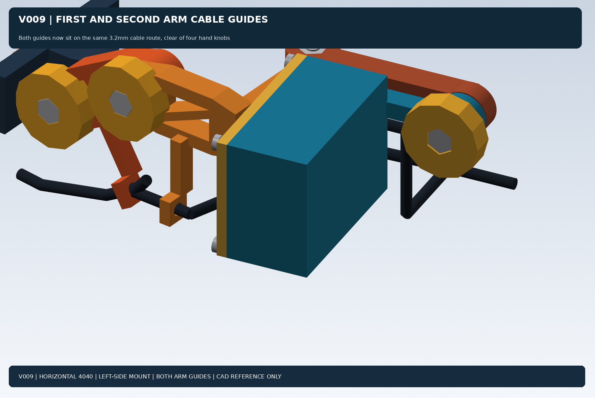
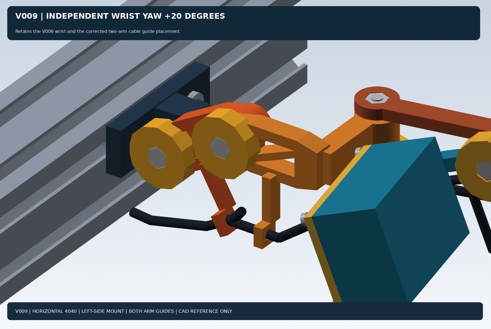
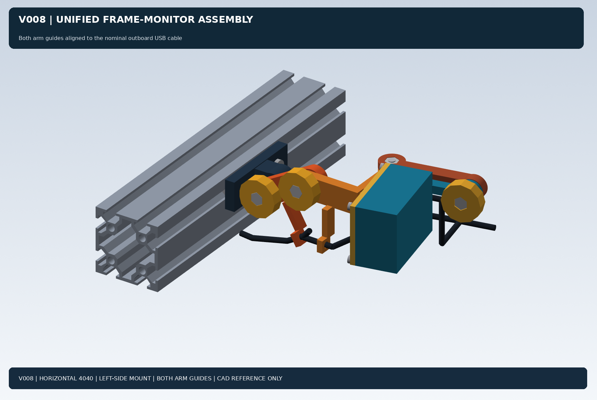

# ESP32-CAM-MB | Parametric Frame Monitor

**A little camera, a horizontal 4040 rail, four hand-adjustable joints, and two redesigned structural arms.**

*Built by [Cdaprod](https://github.com/Cdaprod) · Python / CadQuery · FreeCAD-compatible STEP · Open hardware prototype*

**Current CAD development release: V009.** Full assembly and sampled cable/joint poses have passed CAD checks; **actual fit, stiffness, strength, and printer travel have not been qualified.**

**Visual-review finding:** V009's triangulated links still retain the two downward-protruding cable guide supports visible in the render. They are a known unresolved design limitation—not the intended integrated-channel geometry. [V010 corrective-design issue #3](https://github.com/Cdaprod/ESP32-CAM-MB-Parametric-Frame-Monitor/issues/3).

[Complete V009 STEP](step/COMPLETE_4040_ESP32_CAM_MB_ASSEMBLY_V009.step) · [New arm STLs](stl/V009_first_arm.stl) · [Engineering notes](docs/ENGINEERING_NOTES_V009.md) · [Validation JSON](docs/validation_v009.json)

## V009 — See the actual redesigned arms


I wanted a camera mount that looks and behaves like a real engineered mechanism, rather than a few rectangles bolted together. V009 replaces **both original flat arms** with tapered, triangularly braced open-web links. The CAD is topology-inspired, not automatically optimized for load.



Both arms preserve the **35 mm pivot-to-pivot dimensions**, use a **14 mm end width and 18 mm midspan width**, and have **7.5 mm nominal thickness**. Each has two triangular lightening windows and a diagonal reinforcement web. Original joint centers and both Ø3.8 mm USB cable-guide bores remain aligned to the nominal Ø3.2 mm lead.



### V009 CAD verification

| Requirement | Checked result |
|---|---:|
| Four hand-adjustable joints (base, elbow, pitch, wrist) | Preserved |
| Assembly entries including reference solids/hardware | 30 |
| Sampled joint configurations | **13 / 13 passed** |
| Newly generated arm STLs | **2 / 2 watertight** |
| Cable guide centerlines | Both aligned |
| Nominal cable-to-guide radial clearance | **0.30 mm** |
| Minimum modeled cable-to-thumbwheel gap | **7.132 mm** |
| Minimum modeled cable-to-rail gap | **3.802 mm** |
| FEA, print testing, stiffness and actual mounting fit | **Not performed** |

**Important:** passing these checks does not demonstrate fatigue strength, cable bend radius or strain relief, continuous collision-free joint motion, or safe clearance over the printer's full axis travel.

## Download / inspect

| File | Direct link |
|---|---|
| Complete assembled rail and monitor | [V009 complete STEP](step/COMPLETE_4040_ESP32_CAM_MB_ASSEMBLY_V009.step) |
| Tapered first arm | [STL](stl/V009_first_arm.stl) · [STEP](step/V009_first_arm.step) |
| Tapered second arm | [STL](stl/V009_second_arm.stl) · [STEP](step/V009_second_arm.step) |
| Real geometry previews | [Assembly](previews/v009_full_assembly.png) · [Guide detail](previews/v009_cable_guides.png) · [Rotated wrist](previews/v009_wrist_20_degrees.png) |
| Current source | [One CLI](src/build.py) · [Parametric package](src/frame_monitor/) |
| Engineering records | [Notes](docs/ENGINEERING_NOTES_V009.md) · [Manifest](docs/manifest_v009.json) · [Validation](docs/validation_v009.json) |
| V009 current release metadata | [CURRENT_RELEASE.json](docs/CURRENT_RELEASE.json) |

The horizontal **4040 extrusion**, **left-side mounting orientation**, **camera aiming over the rail toward the bed**, T-slot locator, metal M5 T-nuts, four adjustable joints, positive camera retention and bottom USB outlet remain part of the assembly.

### One Python build

`/src/build.py`

```bash
python -m pip install -r requirements.txt
python src/build.py build
python src/build.py validate
# Requires Xvfb on headless Linux:
xvfb-run -a python src/build.py render
# Or run everything:
xvfb-run -a python src/build.py all
```

## V008 versus V009

| | V008 | V009 |
|---|---|---|
| Arm shape | Solid plate-style links, supported cable guides | **Tapered braced links, triangular lightening windows** |
| Cables | Both guides aligned | Same guide centerlines retained |
| Four-joint camera positioning | Yes | Yes |
| Validated sampled poses | 13 | 13 |
| Physical strength / load tested | No | No |



[Earlier V008 engineering notes](docs/ENGINEERING_NOTES_V008.md) · [Release history](CHANGELOG.md) · [Recovered original parametric T-slot source](reference/tslot_4040_interface.scad)

## What needs real-world verification

The recovered 4040 slot, real ESP32-CAM-MB stack and USB connector, metal fasteners, minimum cable bend radius, printed bearing surfaces, and full printer travel all need measuring and testing. A controlled, identical-loading V008-versus-V009 printed deflection comparison is the right next step to determine whether the redesign really performs better.

---

*I build, measure, break assumptions, redesign, and share the Python that made it—because the engineering journey should be reproducible.* — [Cdaprod](https://github.com/Cdaprod)

**#DevOpsDad · #HackThePlanet · #3DPrinting · #OpenHardware**
