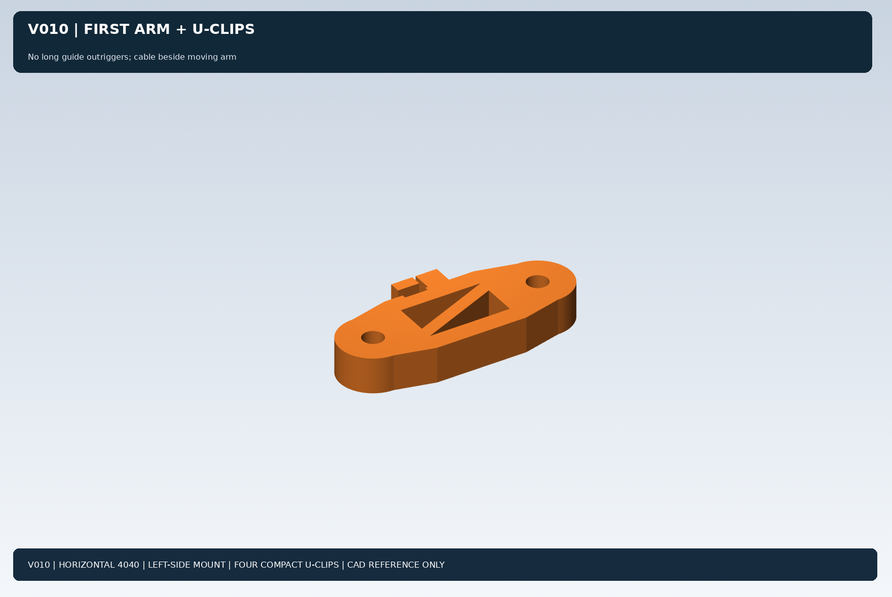
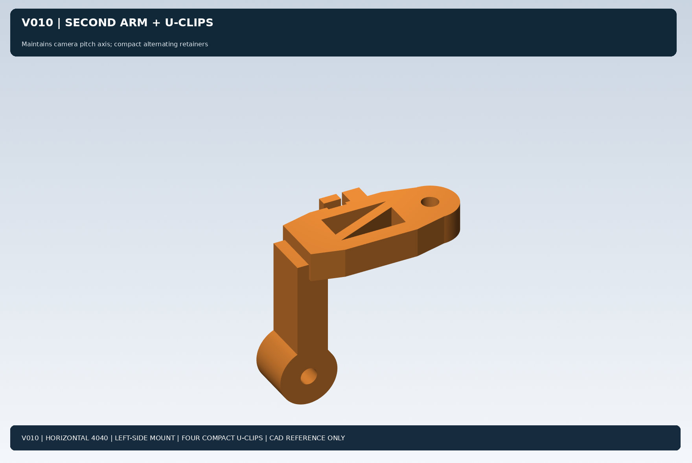
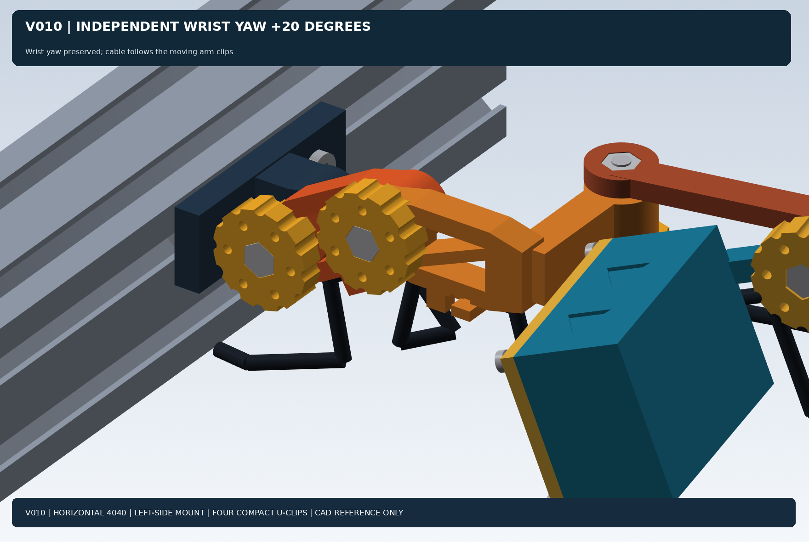

# ESP32-CAM-MB · Parametric Frame Monitor

**V010 — Four compact alternating cable clips, topology-inspired links, tactile knobs and relieved enclosure.**

Built by [Cdaprod](https://github.com/Cdaprod) with **Python + CadQuery**, real STEP/STL models, and actual geometry-derived renders.

**Current development release: V010 (CAD-only prototype).** Real cable bending, snap-fit fatigue, 4040 rail fit, camera connector geometry, fastener preload, and full printer travel remain physically unverified.


## Why V010 exists

**Visual correction:** The cable seats are now cut into directly reinforced arm sidewalls, inside the original 7.5 mm link thickness. The old suspended rings, long feet and vertical webs have been removed. The connected routing groove runs along each moving link; there is no remote cable-support arm. These are nominal snap-fit candidates, not physically qualified retainers.


The V008/V009 cable supports were essentially two long arms carrying the wire far away from the structural links. Those outriggers were never justified by the hardware. I wanted four small, alternating open U-clips following the link surfaces—not a longer version of the same mistake.

V010 retains the **35 mm pivot-center spacing**, horizontal 4040 rail, left-side mounting plate, metal M5 T-nuts, four hand-operated M4 adjustment joints and captive camera housing. It replaces the outboard ring-and-web guide with **two integral sidewall cable seats on each articulating link**. The clip entry sides alternate (-X, +Z, -X, +Z in each link's local geometry). The nominal 3.2 mm USB cable now follows the link bodies, with unconstrained transitions at the articulated joints.


### Isolated mechanical components








### CAD validation results

| Check | V010 CAD result |
|---|---:|
| Sampled base/elbow/pitch/wrist poses | **18 / 18 pass** |
| Distinct U-shaped, short retained clips | 4 |
| Long cable outrigger webs | 0 |
| Printable single-volume watertight new parts | **4 / 4 pass** |
| Nominal cable diameter | 3.2 mm |
| Nominal U-seat internal diameter | 3.8 mm |
| Nominal radial cable/clip gap | 0.30 mm |
| Nominal clip entry throat | 2.65 mm |
| Minimum modeled cable/knob clearance | **1.650 mm** |
| Minimum modeled cable/rail clearance | **3.802 mm** |
| Full continuous joint-envelope proof | **Not performed** |
| Real printed clip fatigue and cable bend | **Not verified** |

The 2.65 mm throat is narrower than the nominal 3.2 mm cable. Whether the printed plastic and actual cable jacket can tolerate repeated insertion **has not been established**. Cable paths are faceted cylindrical *reference geometry*, not a strain-controlled flexible cable simulation.

## Download the actual V010 models

| Item | STEP | Printable STL |
|---|---|---|
| Entire installed assembly | [V010 assembly](step/COMPLETE_4040_ESP32_CAM_MB_ASSEMBLY_V010.step) | — |
| First tapered arm | [STEP](step/V010_first_arm.step) | [STL](stl/V010_first_arm.stl) |
| Second tapered arm | [STEP](step/V010_second_arm.step) | [STL](stl/V010_second_arm.stl) |
| Scalloped hand knob (print four) | [STEP](step/V010_scalloped_thumbwheel.step) | [STL](stl/V010_scalloped_thumbwheel.stl) |
| Relieved camera shell | [STEP](step/V010_relieved_camera_shell.step) | [STL](stl/V010_relieved_camera_shell.stl) |

The existing **V004** alignment key, mounting plate and bezel, and **V006** wrist adapter remain compatible; their historical exports are preserved. Use **V010's** camera shell, both arms and knob for new V010 assembly prints.

## One build command

`/src/build.py`

```bash
python -m pip install -r requirements.txt
python src/build.py build
python src/build.py validate
xvfb-run -a python src/build.py render
# Or all three in one invocation
xvfb-run -a python src/build.py all
```

- [Parametric dimensions](src/frame_monitor/config.py), [part geometry](src/frame_monitor/geometry.py), [kinematic cable path](src/frame_monitor/cable.py)
- [Machine-readable validation](docs/validation_v010.json), [assembly manifest](docs/manifest_v010.json), [engineering notes](docs/ENGINEERING_NOTES_V010.md), [BOM](docs/BOM.csv)
- [Design history](CHANGELOG.md) and [GitHub tracking issue #3](https://github.com/Cdaprod/ESP32-CAM-MB-Parametric-Frame-Monitor/issues/3)

### Still open for subsequent iterations

This revision also updates the grip surface of the thumbwheel and produces shallow pocket reliefs on the camera housing. However, the **wrist adapter and 4040 mounting plate have not received topology-inspired shape revisions yet**. They remain structurally aligned with previous CAD. The cable still needs a physical strain-relief strategy at the ESP32-CAM-MB connector and proof of minimum cable bend radius around the joints.


V009 remains archived for comparison; don't mistake its validated guide geometry for V010. **No claims of FEA, topology optimization, stronger links or print-tested cable retention are made.**

*An engineering project by [Cdaprod](https://github.com/Cdaprod): build it, measure it, improve it, and publish the real CAD.*