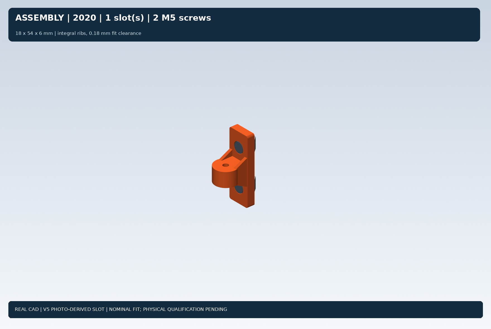
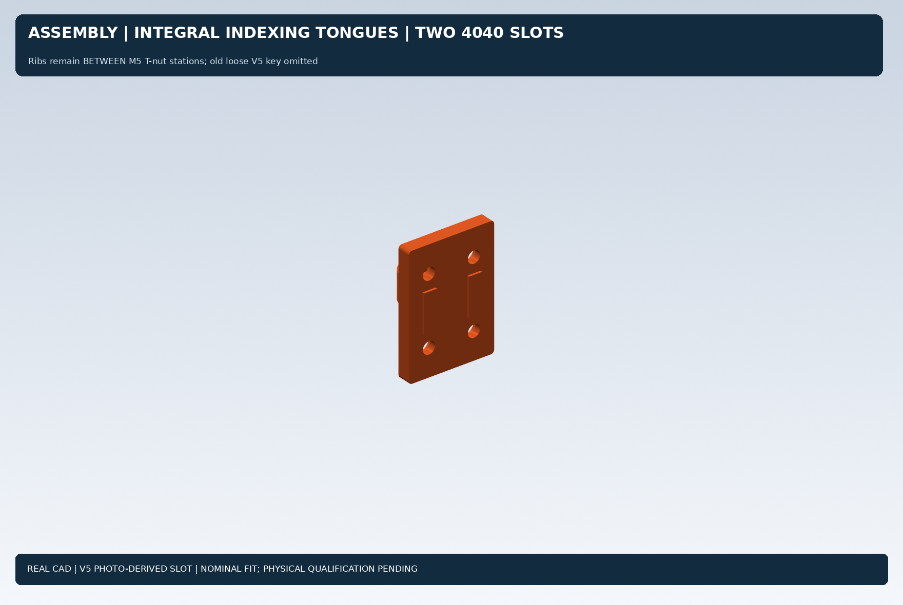
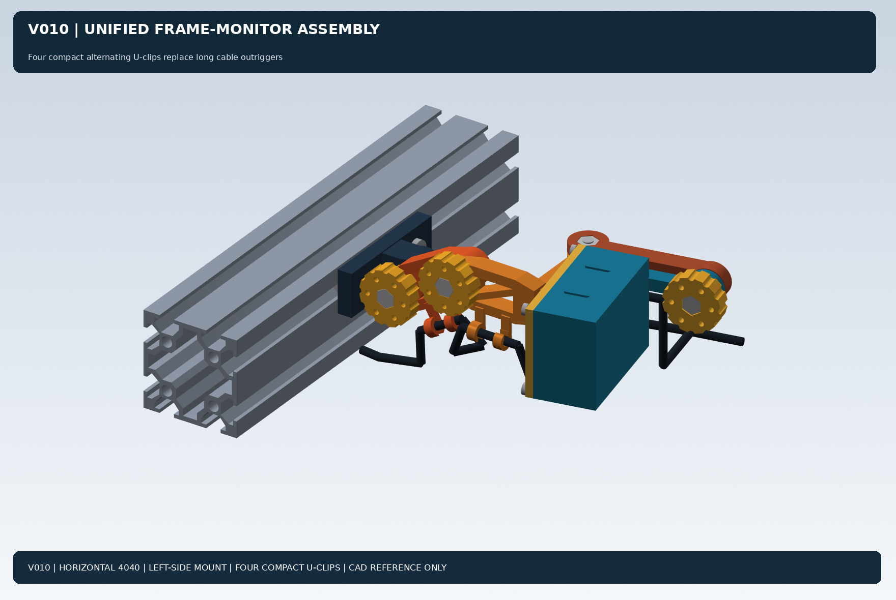
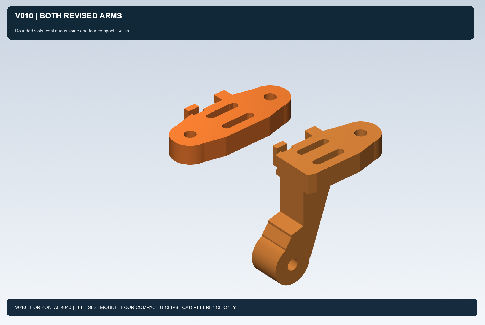
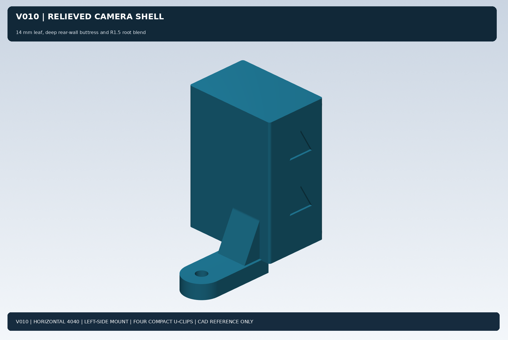
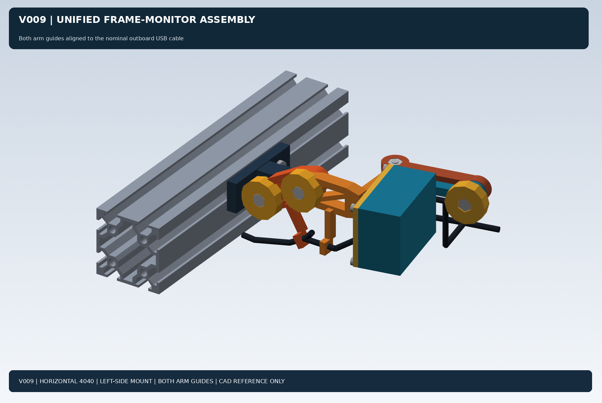

# ESP32-CAM-MB · Parametric Frame Monitor

**V010 — Four compact alternating cable clips, topology-inspired links, tactile knobs and relieved enclosure.**

Built by [Cdaprod](https://github.com/Cdaprod) with **Python + CadQuery**, real STEP/STL models, and actual geometry-derived renders.

**Current development release: V010 (CAD-only prototype; NOT print-qualified).** Real cable bending, snap-fit fatigue, 4040 rail fit, camera connector geometry, fastener preload, and full printer travel remain physically unverified.

**Print-readiness audit:** [12 prioritized, source-verified defects and acceptance gates](docs/PRINT_READINESS_AUDIT_V010.md) · [GitHub issue #5](https://github.com/Cdaprod/ESP32-CAM-MB-Parametric-Frame-Monitor/issues/5). **Do not install V010 on a moving printer** based only on CAD watertightness or screenshot appearance.

## Parametric 2020 / 4040 extrusion mounting brackets

**New feature — CAD engineering candidate, not an integrated V010 replacement.** The same one-piece gusseted bracket generator scales from one centered 2020 slot to two parallel 4040 slots at 20 mm pitch. M5 metal T-nuts provide clamp force; integral indexing tongues sit **between** screw stations, eliminating interference with the separate historical V5 key. An M4 camera-arm pivot retains the `Y = -17 mm` datum.

[**Open the offline interactive mounting-interface model selector**](viewer/mount_interface.html) · [Dimensional constraints, construction and installation](docs/MOUNTING_INTERFACE.md) · [Parametric CadQuery source](src/frame_monitor/mount_interface.py) · [Physical fit register](docs/MOUNTING_FIT_REGISTER.csv).

| Preset | Parallel slots | M5 screws | One-piece plate |
|---|---:|---:|---|
| 2020 single | 1 | 2 | 18 × 54 × 6 mm |
| 4040 dual | 2 | 4 | 38 × 54 × 6 mm |
| 4040 extended | 2 | 8 | 38 × 114 × 6 mm |






Print-ready bracket exports are *not claimed*: physical slot fit, fastener preload, build orientation, bending strength and full printer motion still require validation. Actual STEP/STL variants are published in `step/MOUNT_*.step` and `stl/MOUNT_*.stl`. The `V010` assembly is preserved as-is until physical integration can be proved.

## Explore the latest assembly in 3D

[](viewer/index.html)

**[Open/download the current interactive offline HTML viewer](viewer/index.html)** · [Complete color-coded GLB](viewer/COMPLETE_ASSEMBLY.glb) · [Viewer version and checksums](viewer/release.json)

Orbit, zoom and toggle individual component groups in the standalone viewer. The viewer now retains the complete CAD tessellation rather than omitting triangles, and the cable reference is now a continuous, parameter-driven, pose-dependent tube with exact circular tangent arcs (physical cable bending remains unverified). Its HTML bundles the JavaScript, so after downloading you can open it on your phone or computer without an internet connection. GitHub README pages cannot execute embedded HTML or iframes; this linked preview opens the viewer file, which can be downloaded locally. The same viewer can also be hosted online through GitHub Pages when Pages is enabled.


**V010 finishing update:** Both structural arms now use R0.70 mm fillets on re-entrant triangular web corners and R1.0 mm exterior taper blends. The handwheel grip rims have 0.80 mm chamfers; the camera shell has R0.90 mm exterior corner fillets. The bezel and 4040 mounting-plate edges receive 0.30 mm chamfers and the wrist bridge R0.70 mm fillets. All pivot bores, captive-nut pockets, T-slot datums and USB clip throats are preserved. The images below are regenerated from actual finished BREP geometry.

## Why V010 exists

**Visual correction:** The cable seats are now cut into directly reinforced arm sidewalls, inside the original 7.5 mm link thickness. The old suspended rings, long feet and vertical webs have been removed. The connected routing groove runs along each moving link; there is no remote cable-support arm. These are nominal snap-fit candidates, not physically qualified retainers.


The V008/V009 cable supports were essentially two long arms carrying the wire far away from the structural links. Those outriggers were never justified by the hardware. I wanted four small, alternating open U-clips following the link surfaces—not a longer version of the same mistake.

V010 retains the **35 mm pivot-center spacing**, horizontal 4040 rail, left-side mounting plate, metal M5 T-nuts, four hand-operated M4 adjustment joints and captive camera housing. It replaces the outboard ring-and-web guide with **two integral sidewall cable seats on each articulating link**. The clip entry sides alternate (-X, +Z, -X, +Z in each link's local geometry). The nominal 3.2 mm USB cable now follows the link bodies, with unconstrained transitions at the articulated joints.



### Isolated mechanical components





### CAD validation results

| Check | V010 CAD result |
|---|---:|
| Sampled base/elbow/pitch/wrist poses | **18 / 18 pass** |
| Distinct U-shaped, short retained clips | 4 |
| Long cable outrigger webs | 0 |
| Printable single-volume watertight new parts | **4 / 4 pass** |
| Nominal cable diameter | 3.2 mm |
| Nominal U-seat internal diameter | 3.8 mm |
| Nominal radial cable/clip gap | 0.30 mm |
| Nominal clip entry throat | 2.65 mm |
| Minimum modeled cable/knob clearance | **1.887 mm** |
| Minimum modeled cable/rail clearance | **4.147 mm** |
| Requested cable-reference bend radius | **6.0 mm** (locally reduced as required) |
| Full continuous joint-envelope proof | **Not performed** |
| Real printed clip fatigue and cable bend | **Not verified** |

The 2.65 mm throat is narrower than the nominal 3.2 mm cable. Whether the printed plastic and actual cable jacket can tolerate repeated insertion **has not been established**. Cable routing uses one continuous round sweep over exact tangent arcs, but is still *reference geometry*, not a strain-controlled flexible cable simulation. Modeled bends can be tighter than the requested 6 mm; inspect the achieved radius in the validation JSON.

## Download the actual V010 models

| Item | STEP | Printable STL |
|---|---|---|
| Entire installed assembly | [V010 assembly](step/COMPLETE_4040_ESP32_CAM_MB_ASSEMBLY_V010.step) | — |
| First tapered arm | [STEP](step/V010_first_arm.step) | [STL](stl/V010_first_arm.stl) |
| Second tapered arm | [STEP](step/V010_second_arm.step) | [STL](stl/V010_second_arm.stl) |
| Scalloped hand knob (print four) | [STEP](step/V010_scalloped_thumbwheel.step) | [STL](stl/V010_scalloped_thumbwheel.stl) |
| Relieved camera shell | [STEP](step/V010_relieved_camera_shell.step) | [STL](stl/V010_relieved_camera_shell.stl) |

The existing **V004** alignment key, mounting plate and bezel, and **V006** wrist adapter remain compatible; their historical exports are preserved. Use **V010's** camera shell, both arms and knob for new V010 assembly prints.

## One build command

`/src/build.py`

```bash
python -m pip install -r requirements.txt
python src/build.py build
python src/build.py validate
xvfb-run -a python src/build.py render  # also refreshes viewer/index.html and GLB
python src/build.py viewer               # refresh viewer only, from current models
python src/build.py mounts  # regenerate parametric 2020 and 4040 bracket family
# Rebuild V010 and mount interface from their current sources
xvfb-run -a python src/build.py all
```

- [Parametric dimensions](src/frame_monitor/config.py), [part geometry](src/frame_monitor/geometry.py), [kinematic cable path](src/frame_monitor/cable.py)
- [Machine-readable validation](docs/validation_v010.json), [assembly manifest](docs/manifest_v010.json), [engineering notes](docs/ENGINEERING_NOTES_V010.md), [BOM](docs/BOM.csv)
- [Design history](CHANGELOG.md) and [GitHub tracking issue #3](https://github.com/Cdaprod/ESP32-CAM-MB-Parametric-Frame-Monitor/issues/3)

### Still open for subsequent iterations

This revision also updates the grip surface of the thumbwheel and produces shallow pocket reliefs on the camera housing. However, the **wrist adapter and 4040 mounting plate have not received topology-inspired shape revisions yet**. They remain structurally aligned with previous CAD. The cable still needs a physical strain-relief strategy at the ESP32-CAM-MB connector and proof of minimum cable bend radius around the joints.



V009 remains archived for comparison; don't mistake its validated guide geometry for V010. **No claims of FEA, topology optimization, stronger links or print-tested cable retention are made.**

*An engineering project by [Cdaprod](https://github.com/Cdaprod): build it, measure it, improve it, and publish the real CAD.*