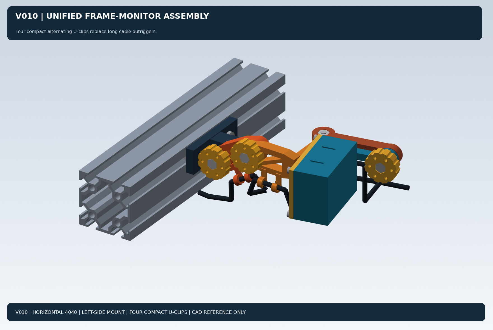
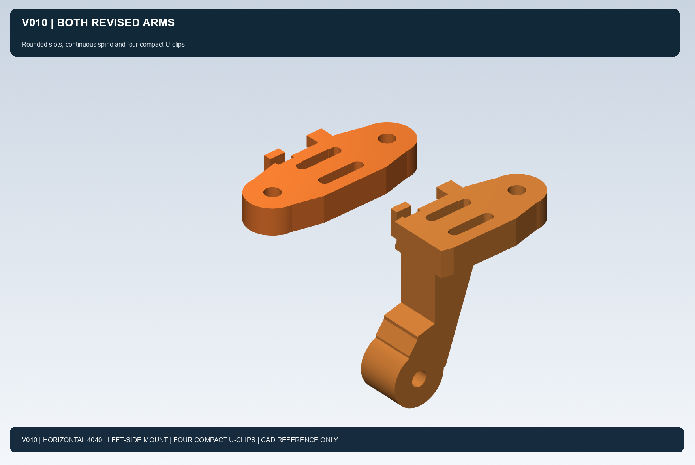
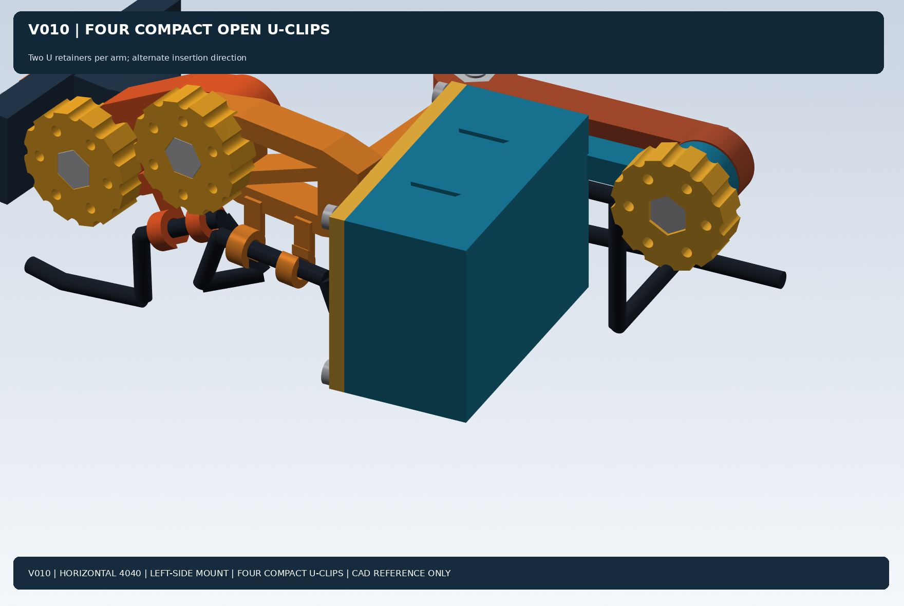
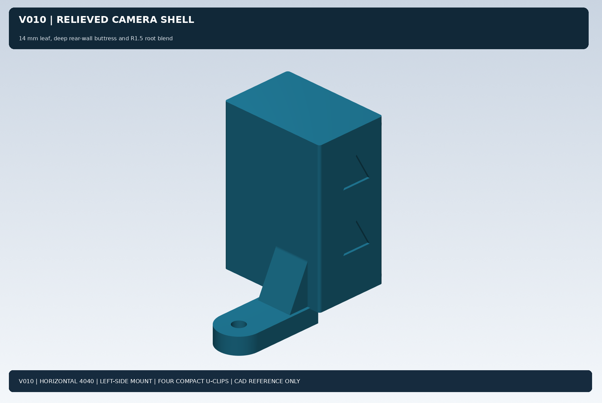

# V010 engineering notes — direct-to-arm cable channels and topology-inspired components

**Current: V010 CAD-only prototype.** The rejected early V010 candidate used short outboard rings and feet connected to the arms; those features were **replaced** by sidewall cable passages in the merged V010 release. The current model has **no dangling guide struts**. Historical V009 remains unchanged.

## Current geometry and mounting invariants

- Two tapered, triangulated structural links preserve **35 mm pivot-to-pivot spacing**, four independently adjustable joints, and the left-mounted horizontal 4040 extrusion configuration.
- Cable Ø3.2 mm nominal; U-shaped sidewall seat Ø3.8 mm; radial cable clearance 0.30 mm; clip throat 2.65 mm. These are modeled reference values, not actual measured cable dimensions.
- **Four** alternating openings (two per articulated arm), with cable routes derived in moving link-local coordinates. The arm sidewalls are locally thickened where necessary, and the seats are formed by cutting the guide geometry into those walls. No separate cable-support arm remains.
- **Current generator parameters:** first link cable seat axis `x = -9.5 mm, z = 10.25 mm`, with positions `y = -32.5/-37.7 mm`; second link axis `x = -9.5 mm, z = 17.75 mm`, with positions `y = -66.0/-72.0 mm`. Values are from the generated [V010 manifest](manifest_v010.json).
- **Current opening sequence:** `-X, +Z, -X, +Z` in the link-local reference frames. Earlier initial-candidate coordinates at `x=-15.5 mm`, longer guide feet, and `-X/+X` orientation are **obsolete** and must not be used when rebuilding V010.
- The hand-operated M4 knob retains its nominal Ø23 mm envelope and captive-nut interface; its scalloped perimeter and relief geometry are CAD styling and ergonomic candidates, not proven fatigue or torque improvements.
- The camera shell retains the nominal board/optical/bezel/wrist interfaces and introduces four shallow exterior wall-relief pockets (0.8 mm recess into the nominal 3 mm wall, leaving a modeled 2.2 mm residual wall). Physical print tolerances remain unverified.
- The 4040 mounting plate and wrist adapter remain preserved from earlier versions; topology-inspired revisions are still pending.

## Actual CAD renders

## Reproducible verification results

The authoritative report is [`validation_v010.json`](validation_v010.json). On the current nominal geometry:

| Geometry/assembly check | Verified CAD result |
|---|---:|
| Sampled articulated poses | **18 / 18 pass** |
| Four integrated cable seats | **4** |
| Long cable-support outriggers | **0** |
| New valid, watertight single-body printed models | **4 / 4** |
| Minimum cable-to-handwheel separation | **1.650 mm** |
| Minimum cable-to-extrusion separation | **3.802 mm** |
| Nominal radial gap in a 3.8 mm seat around Ø3.2 mm cable | **0.30 mm** |

The reference cable path is made from faceted cylindrical solids and does not simulate elastic deformation, fatigue, dynamic bend radius, sag, jacket wear, or connector boot strain. The 2.65 mm nominal snap throat is smaller than the modeled cable jacket and has **not** been tested for repeated insertion or removal. Full printer axis travel, real rail fastener engagement, static deflection and vibration also remain unverified.

[Physical fit register](PHYSICAL_FIT_REGISTER_V010.csv) · [Current BOM](BOM.csv) · [Complete STEP assembly](../step/COMPLETE_4040_ESP32_CAM_MB_ASSEMBLY_V010.step).
