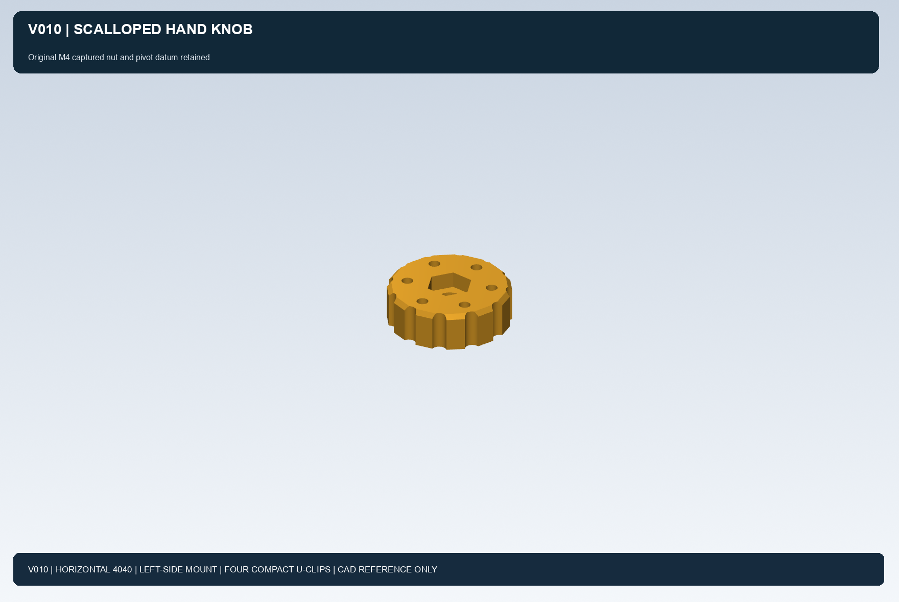

# V010 engineering notes — direct-to-arm cable channels and topology-inspired components

**Current: V010 CAD-only prototype.** The rejected early V010 candidate used short outboard rings and feet connected to the arms; those features were **replaced** by sidewall cable passages in the merged V010 release. The current model has **no dangling guide struts**. Historical V009 remains unchanged.

## Current geometry and mounting invariants

- Two tapered, triangulated structural links preserve **35 mm pivot-to-pivot spacing**, four independently adjustable joints, and the left-mounted horizontal 4040 extrusion configuration.
- Cable Ø3.2 mm nominal; U-shaped sidewall seat Ø3.8 mm; radial cable clearance 0.30 mm; clip throat 2.65 mm. These are modeled reference values, not actual measured cable dimensions.
- **Four** alternating openings (two per articulated arm), with cable routes derived in moving link-local coordinates. The arm sidewalls are locally thickened where necessary, and the seats are formed by cutting the guide geometry into those walls. No separate cable-support arm remains.
- **Current generator parameters:** first link cable seat axis `x = -9.5 mm, z = 10.25 mm`, with positions `y = -32.5/-37.7 mm`; second link axis `x = -9.5 mm, z = 17.75 mm`, with positions `y = -66.0/-72.0 mm`. Values are from the generated [V010 manifest](manifest_v010.json).
- **Current opening sequence:** `-X, +Z, -X, +Z` in the link-local reference frames. Earlier initial-candidate coordinates at `x=-15.5 mm`, longer guide feet, and `-X/+X` orientation are **obsolete** and must not be used when rebuilding V010.
- The hand-operated M4 knob retains its nominal Ø23 mm envelope and captive-nut interface; its scalloped perimeter and relief geometry are CAD styling and ergonomic candidates, not proven fatigue or torque improvements.
- The camera shell retains the nominal board/optical/bezel/wrist interfaces and introduces four shallow exterior wall-relief pockets (0.8 mm recess into the nominal 3 mm wall, leaving a modeled 2.2 mm residual wall). Physical print tolerances remain unverified.
- The 4040 mounting plate and wrist adapter remain preserved from earlier versions; topology-inspired revisions are still pending.

## Actual CAD renders

## Reproducible verification results

The authoritative report is [`validation_v010.json`](validation_v010.json). On the current nominal geometry:

| Geometry/assembly check | Verified CAD result |
|---|---:|
| Sampled articulated poses | **18 / 18 pass** |
| Four integrated cable seats | **4** |
| Long cable-support outriggers | **0** |
| New valid, watertight single-body printed models | **4 / 4** |
| Minimum cable-to-handwheel separation | **1.887 mm** |
| Minimum cable-to-extrusion separation | **4.147 mm** |
| Nominal radial gap in a 3.8 mm seat around Ø3.2 mm cable | **0.30 mm** |

The V010 cable reference is a single round swept solid following pose-dependent tangent circular arcs, rather than separate faceted cylinders. Its effective geometrically drawn radii are recorded per pose. It does not simulate elastic deformation, fatigue, required dynamic bend radius, sag, jacket wear, or connector boot strain. The 2.65 mm nominal snap throat is smaller than the modeled cable jacket and has **not** been tested for repeated insertion or removal. Full printer axis travel, real rail fastener engagement, static deflection and vibration also remain unverified.

[Physical fit register](PHYSICAL_FIT_REGISTER_V010.csv) · [Current BOM](BOM.csv) · [Complete STEP assembly](../step/COMPLETE_4040_ESP32_CAM_MB_ASSEMBLY_V010.step).

## Engineering polish — 2026-11-24

Patched in the active CadQuery source, without conversion to another CAD system.

- Replace acute triangular arm cutouts with two 13 × 3 mm rounded slots. Within the slotted region, the nominal 18 mm body retains a 5 mm center spine, 3.5 mm outer rails, and R1.5 slot ends. This trades some material for continuous sections and removes acute web corners; no topology optimization or strength claim is made.
- Widen the wrist bridge outward from 4.35 to 6.35 mm and add a 31 mm tapered underside rib, up to 4 mm deeper than the original bridge. Preserve pitch/wrist bores, nut seats and journal datums. Check this additional envelope against the actual printer.
- Increase nominal clip throat from 2.65 to 3.0 mm: diametral interference decreases from 0.55 to 0.20 mm for the assumed 3.2 mm cable. Retention, insertion force and material compliance require measured coupons; do not infer fatigue performance.
- Validate all eight unique printed designs, including inherited key, mount, bezel and updated wrist. Preserve historical wrist exports and publish the active wrist as V010.
- Give the standalone offline viewer a separate legend area and reset-view control. Use portable annotation fonts for macOS/Linux builds. Run CAD CI on pull requests before merge.

Acceptance still requires measured camera/USB boot dimensions, cable bend and strain relief, material and orientation selection, slicing, clip coupons, clamp/load tests and unpowered full-travel clearance checks. The existing 18 sampled poses establish neither a continuous collision-free envelope nor a structural load rating. No physical printer operation is included.

### Verified results

All eight printed-design meshes pass single-body, watertight, positive-volume and BREP/STL volume agreement checks. All 18 sampled cable poses pass; minimum cable/knob gap remains 1.887 mm. Finished-solid and center-spine section witnesses pass. Eight geometry-derived previews, STEP, STL, GLB and offline HTML were regenerated; release checksums pass. Chrome was inspected at 390 × 844: all four wrapping visibility controls are visible and frame visibility toggles correctly.

Offline OrcaSlicer 2.5.0-rc first-arm feasibility slice: installed Elegoo Neptune 2 0.4 mm nozzle / Balanced 0.20 mm process / Panchroma PLA Matte settings, 4 walls, 30% infill. Result: 37 layers, estimated 30m47s and 4.86 g. The CLI initially failed resolving inherited presets; temporary flattened copies of installed system/user profiles succeeded. No installed profile was changed. G-code remains temporary local analysis output, not a qualified printing recommendation. No printer was contacted. Other parts have not been slice-qualified.
