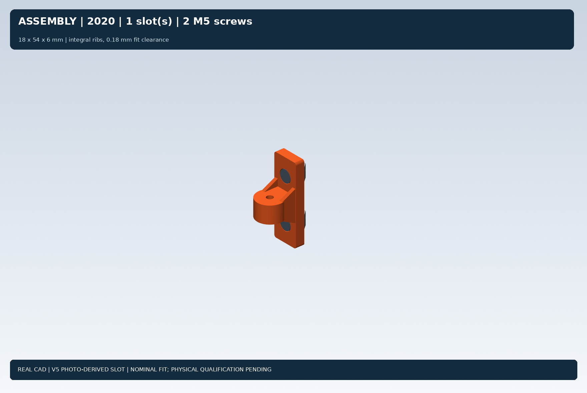
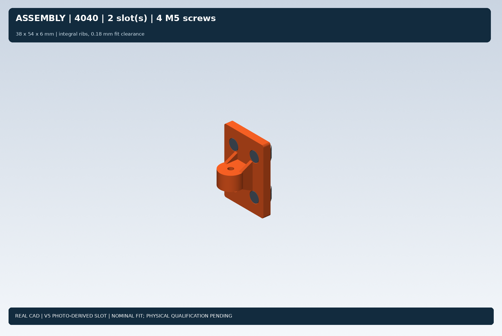
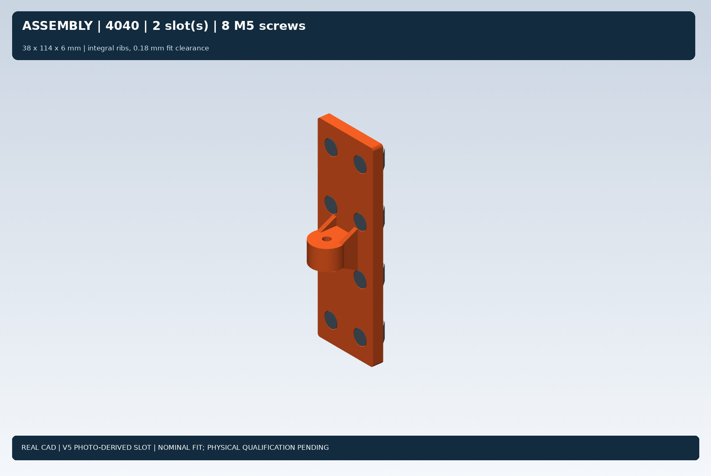
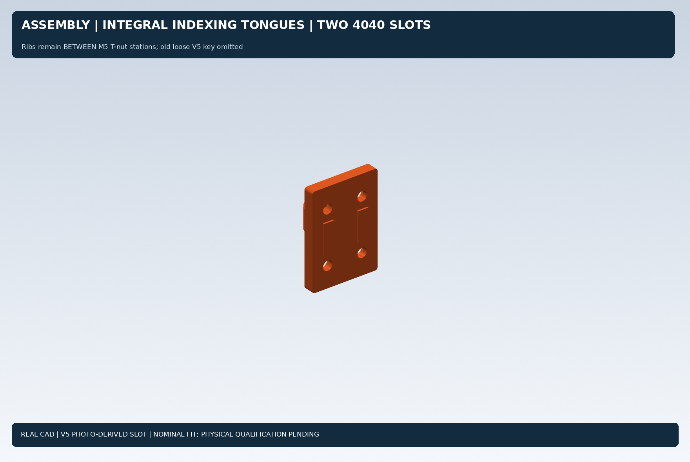

# Parametric 2020 / 4040 extrusion mounting interface

**CAD-only mounting feature.** Generated separately from the active V010 four-joint assembly. No physical fit, load, or machine-travel qualification is claimed.

The Loc-Line-inspired example motivated a general-purpose **single-piece mounting bracket**, not a copy of its model. The same CadQuery source generates one or two parallel slot rows, independent metal M5 clamp hardware and an M4 camera-arm pivot with load-spreading gussets.

## Real geometry-derived previews

### 2020: one parallel slot and two M5 screws



### 4040: two 20-mm-spaced slots, four M5 screws



### Longer 4040: eight M5 screws (four per channel)



### Integral locating tongues, rear-face geometry



[Open the **standalone offline interactive mounting-interface viewer**](../viewer/mount_interface.html) · [Parametric source](../src/frame_monitor/mount_interface.py) · [Generated manifest](mount_interface_manifest.json)

## Parametric dimensional contract

| Variant | Channel centers X | Screw stations Z | M5 count | Plate width × length × thickness |
|---|---|---|---:|---|
| 2020 single | 0 mm | −15, +15 mm | 2 | 18 × 54 × 6 mm |
| 4040 dual | −10, +10 mm | −15, +15 mm | 4 | 38 × 54 × 6 mm |
| 4040 extended | −10, +10 mm | −45, −15, +15, +45 mm | 8 | 38 × 114 × 6 mm |
| 4040 single (API) | local 0, choose actual side ±10 mm | −15, +15 mm | 2 | 18 × 54 × 6 mm |

Parameters are in \`MountSpec\`: \`extrusion_size_mm\`, \`channel_count\`, \`selected_4040_slot\`, \`longitudinal_screws_per_slot\`, \`screw_pitch_mm\`, \`axial_end_margin_mm\`, \`transverse_edge_margin_mm\`, \`plate_thickness_mm\`, \`tongue_mode\`, M4 hub dimensions, M5 holes/counterbores and recovered slot profile/clearance.

For screw count \(n\) per slot and pitch \(P\), screw centers are \(z_i=(i-(n-1)/2)P\), and required plate length is \(L=(n-1)P+2m\), with \(m\) the terminal margin. Width is \(W=(\text{largest channel X}-\text{smallest channel X})+2e\), where \(e\) is the lateral margin. Thus adding screws automatically extends the plate rather than simply crowding fastener holes together.

The default screw hole is Ø5.4 mm with Ø9 × 3 mm counterbore. The original M4 joint axis remains at Y = −17 mm from the extrusion bearing face; the central bridge and both web gussets are parametric. Metal T-nuts supply clamping force.

## Prevent interference between the reduced V5 key and new bracket tongues

The historical separate \`V004_recessed_alignment_key\` is **not installed with this new family**. In default \`tongue_mode='mouth'\`, the bracket contains integrated **shallow mouth-entry ribs** approximately 5.84 mm wide, projecting 1.0 mm into the V5 6.20 mm slot opening and stopping short of the 1.50 mm lip depth. The recovered slot profile is a *prototype reference*, and a 2020 extrusion is **not guaranteed to have the same profile**.

Each tongue exists only in the clear span *between* longitudinal nut locations. The interval between adjacent M5 stations is \([z_i+\ell/2+g,\,z_{i+1}-\ell/2-g]\), where nominal T-nut length \(\ell=9\) mm and guard \(g=2\) mm. At 30 mm screw pitch that yields 17 mm of locating rib between screw stations, with no volume conflict against the nut envelopes. **Do not stack the old V5 key into the same slot.**

An optional \`tongue_mode='slide_in_t_head'\` creates an actual undercut T-shaped male profile: this can only be inserted axially from a free end of the rail and must be fitted before the nuts obstruct its travel. An \`none\` mode generates a smooth bracket with M5 fasteners only. For quick front-on installation and real printer installations, **mouth mode is the preferred candidate**, pending measurements.

## Validation, generation, and status

\`tests/test_mount_interface.py\` checks dimensional relationships, one connected BREP body, all screw-hole centers, invalid configurations, 2020/4040 nominal rail collision, T-nut separation, positive watertight STL volume, four real preview PNGs, and the independent offline viewer. This **does not establish FDM strength** or the physical fit of any photo-derived reference geometry.

Before use, measure actual slot mouth and undercut, screw head/engagement, nut geometry, brim/slicer support requirements, print orientation, heat/vibration exposure and full unpowered printer travel. Do not claim a print-safe or running-printer-safe release from geometry checks alone.

\`/src/build_mount_interface.py\`

```bash
python -m pip install -r requirements.txt
xvfb-run -a python src/build_mount_interface.py
python tests/test_mount_interface.py
# One command to reproduce both active V010 and mounting-interface artifacts:
xvfb-run -a python src/build.py all
```

Outputs: `step/MOUNT_*.step`, `stl/MOUNT_*.stl`, `previews/mount_*.png`, `viewer/mount_interface.html`, `viewer/mount_interface_release.json`, and `docs/mount_interface_manifest.json`. Rendered outputs are generated from **actual CAD**, not illustrations.
