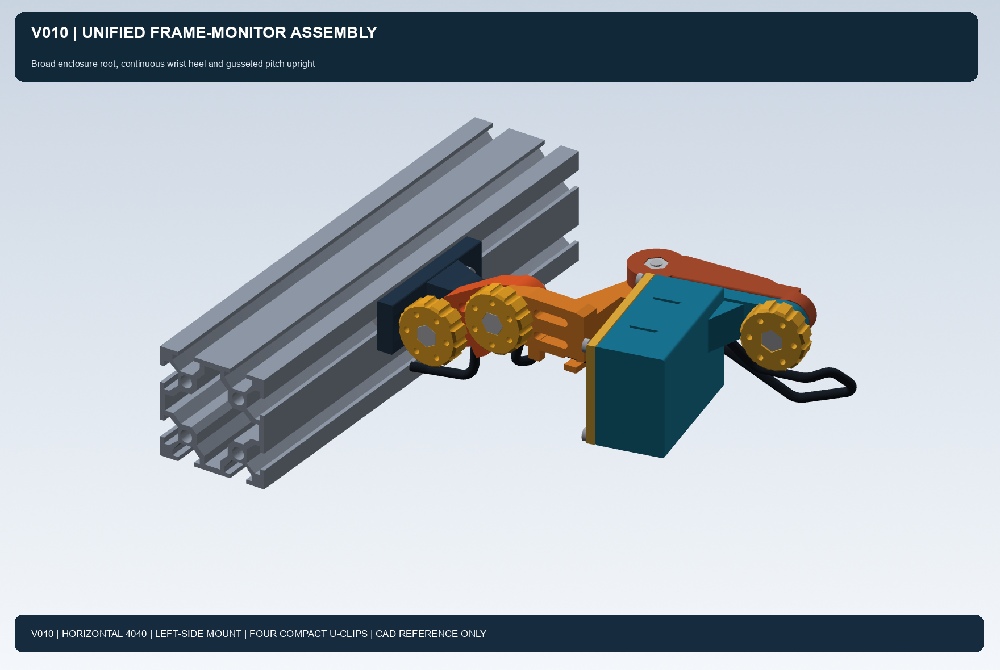
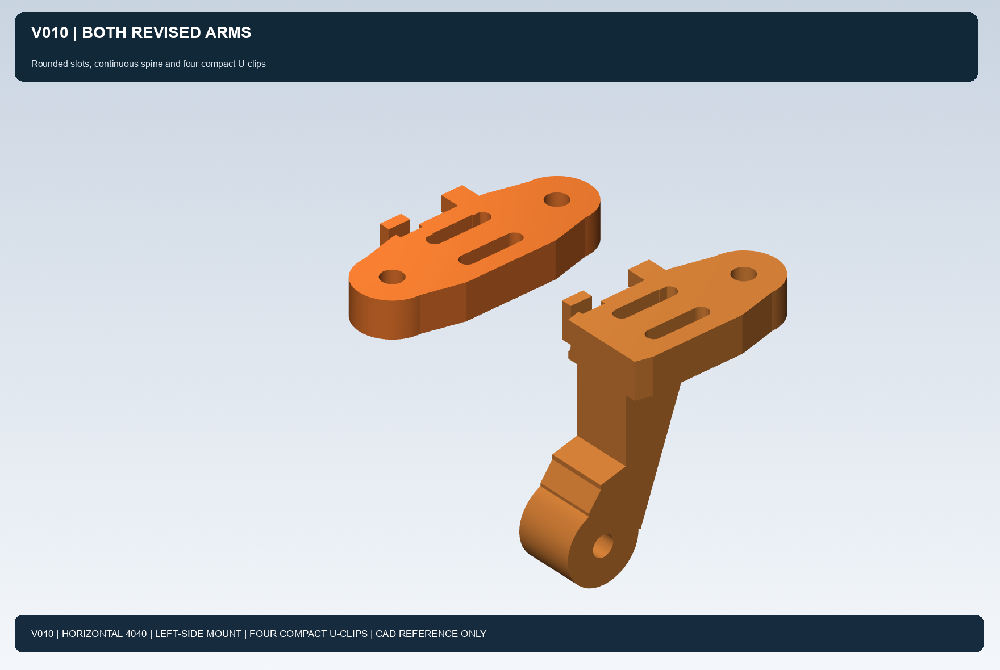
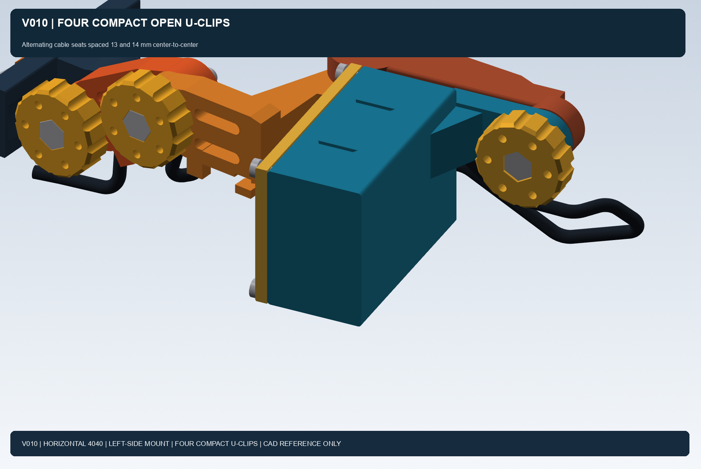
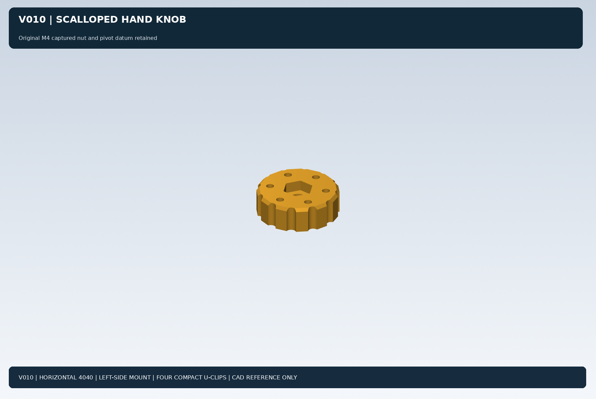
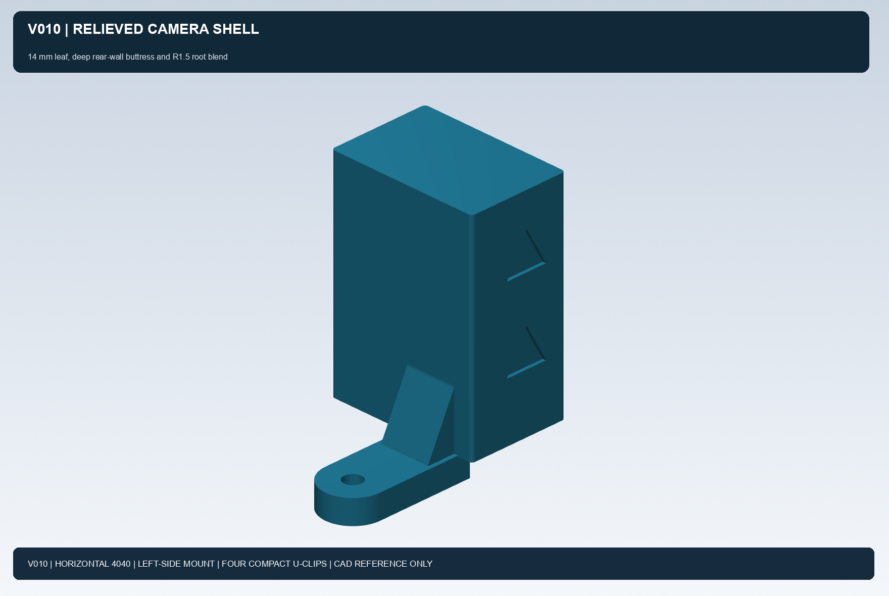

# V010 documentation — current release

**Current CAD release: V010** · [Project README](../README.md) · [Full V010 assembly STEP](../step/COMPLETE_4040_ESP32_CAM_MB_ASSEMBLY_V010.step)

The latest assembly has **four compact cable seats integrated directly into both structural arm sidewalls**, not the old dangling guide supports. Its scalloped knob and shallow camera-shell reliefs are topology-inspired styling candidates. No real-world strength or print-fatigue qualification has been performed.

## Current engineering documents

| Artifact | Purpose |
|---|---|
| [Release JSON](CURRENT_RELEASE.json) | Authoritative current version, model exports and preview paths |
| [Engineering notes](ENGINEERING_NOTES_V010.md) | Corrected link geometry, clip positions, reference dimensions and actual CAD images |
| [Validation report](validation_v010.json) | 18 pose results and measured CAD-only surface clearances |
| [CAD verification scope](VALIDATION_SCOPE.md) | Tests performed and real-world limits |
| [Assembly manifest](manifest_v010.json) | Thirty positioned assembly/reference components and config values |
| [Current BOM](BOM.csv) | V010 hardware and printable parts, matching [V010 snapshot](BOM_V010.csv) |
| [Physical fit register](PHYSICAL_FIT_REGISTER_V010.csv) | Unverified hardware and cable dimensions |
| [Release history](RELEASE_INDEX.md) | V001–V010 lineage and historical references |

## Current interactive assembly viewer

[Offline 3D viewer](../viewer/index.html) · [Full color-coded GLB](../viewer/COMPLETE_ASSEMBLY.glb) · [Viewer integrity manifest](../viewer/release.json). The viewer is regenerated with every set of CAD previews; it never imports the historical V003 model. Download the standalone HTML file and open it locally to interact with the assembly.

## Actual V010 geometry-derived previews

The remaining three images (isolated primary and secondary arm, and +20° camera wrist) are embedded in the [project README](../README.md).

V009 exports remain historical for visual comparison. The documentation and integrity scripts should use the latest values from [`validation_v010.json`](validation_v010.json), especially **3.650 mm** minimum modeled cable-to-knob clearance and **4.147 mm** minimum modeled cable-to-rail clearance, not the obsolete candidate results.
