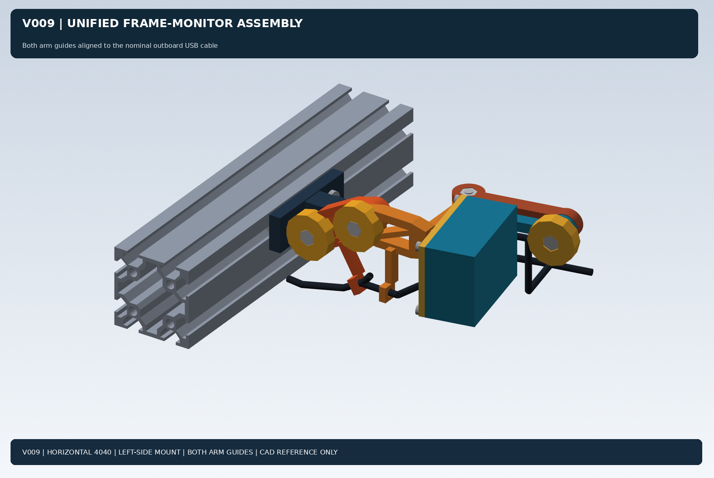
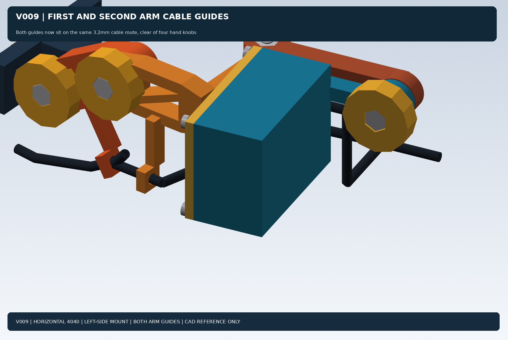

# Release index — V009 current

[README](../README.md) · [Current release JSON](CURRENT_RELEASE.json)

| Revision | Engineering milestone |
|---|---|
| V001 | Initial parametric camera mount |
| V002 | Recovered 4040 extrusion and captured T-slot key |
| V003 | Removable bolted retainer |
| V004 | Recessed key, metal T-nuts, hand knobs and full camera shell |
| V005 | Left-side horizontal 4040 over-rail placement |
| V006 | Independent wrist pivot and USB cable reference |
| V007 | Unreleased dual-guide correction candidate |
| V008 | Unified Python CAD package, aligned dual cable guides |
| **V009** | **Tapered triangulated open-web arm profiles and real verified V009 exports** |

### Current V009 model

[Complete STEP](../step/COMPLETE_4040_ESP32_CAM_MB_ASSEMBLY_V009.step) · [First arm STL](../stl/V009_first_arm.stl) · [Second arm STL](../stl/V009_second_arm.stl)

[Wrist angle render](../previews/v009_wrist_20_degrees.png) · [Engineering details](ENGINEERING_NOTES_V009.md) · [BOM](BOM.csv) · [Validation JSON](validation_v009.json) · [Physical fit register](PHYSICAL_FIT_REGISTER_V009.csv)

**V008 is retained for comparison; the V003 viewer is strictly historical.** V009 is not FEA-optimized or physically load-qualified.
