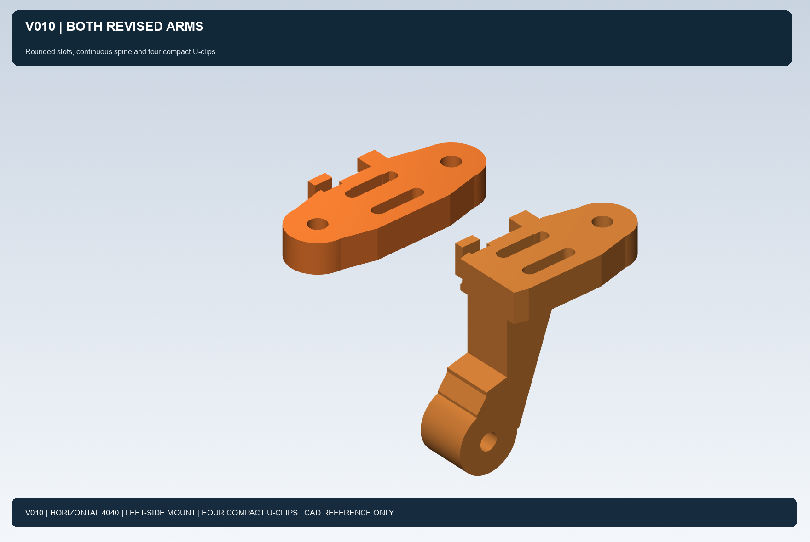
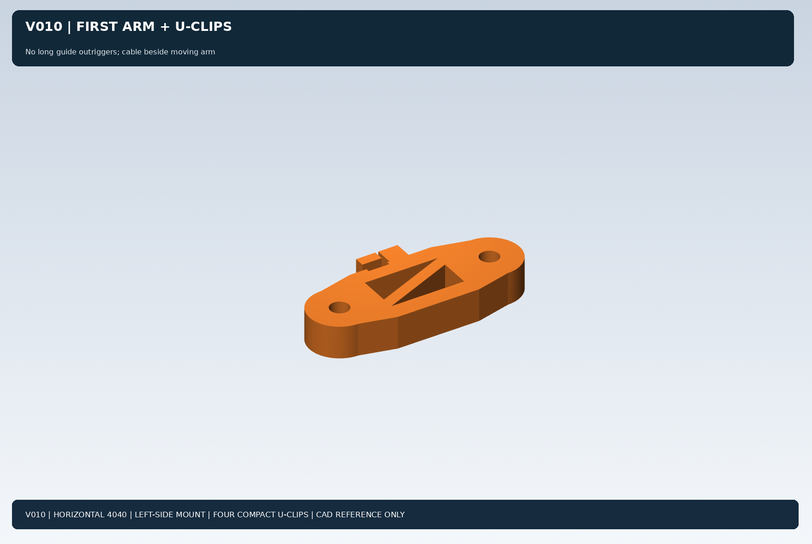
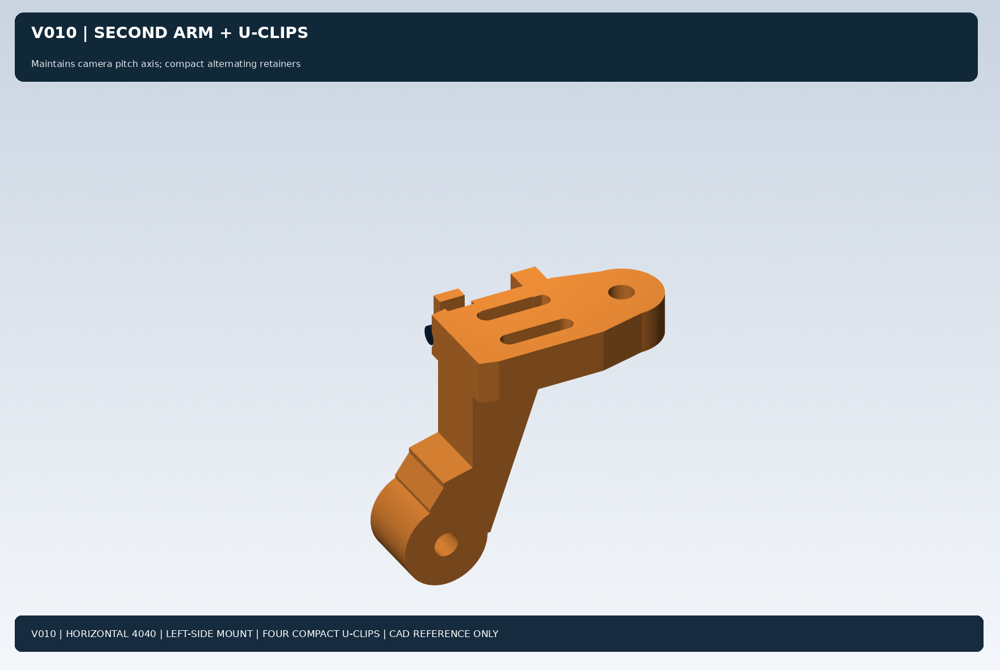

# V010 — CAD-only validation scope

The active reference is [`docs/validation_v010.json`](validation_v010.json). **V010 contains four integrated sidewall cable seats and zero long cable outriggers**. These are CAD claims, not physical qualification.

| Checked measurement | V010 CAD result |
|---|---:|
| Articulated base/elbow/pitch/wrist configurations | **18 / 18 sampled poses pass** |
| Printable watertight single-volume STL parts | **4 / 4** |
| Cable clip count | **4** (two per arm) |
| Long supporting outriggers | **0** |
| Nominal cable diameter | **3.2 mm** |
| Nominal cable-seat diameter | **3.8 mm** |
| Nominal radial clearance | **0.30 mm** |
| Nominal clip insertion throat | **2.65 mm** |
| **Minimum modeled cable-to-knob surface clearance** | **1.887 mm** |
| Minimum modeled cable-to-4040 surface clearance | **4.147 mm** |
| Requested circular bend radius | **6.0 mm** (actual achieved may be smaller; recorded per pose) |

These figures come from the checked-in V010 validation JSON, not the earlier V010 candidate. The earlier **earlier higher clearance estimate** cable-to-knob claim is obsolete for the corrected direct-to-arm cable channels.

**Not tested:** continuous four-axis motion envelopes; real connector boot shape, cable jacket deformation, bending and strain; clip spring response and fatigue; actual 4040 fit, T-nut engagement, pivot preload, print layer strength; bed and toolhead movement, heat, vibration and fatigue. The proposed topology-inspired arm, knob and shell geometry is **not** claimed to be FEA-optimized or physically load-qualified.

[Current engineering notes](ENGINEERING_NOTES_V010.md) · [Latest CAD report](validation_v010.json) · [Physical measurement register](PHYSICAL_FIT_REGISTER_V010.csv) · [Full assembly](../step/COMPLETE_4040_ESP32_CAM_MB_ASSEMBLY_V010.step).

## Actual V010 geometry previews

**Tangent-arc routing correction:** The cable reference is one continuous swept BREP, with rigid-body-local anchors and exactly tangent circular arcs. The reported `cable_route` length and minimum drawn radius are now recomputed for each pose's *base, elbow, pitch and wrist* angles, not from a reset/default pose. Drawn radii remain unqualified for any real cable. [Routing geometry notes](PARAMETRIC_CABLE_ROUTING_V010.md).
